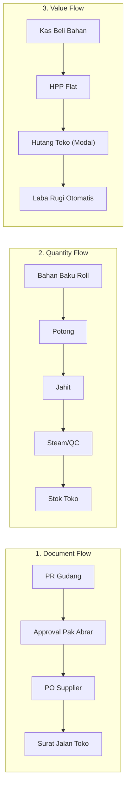
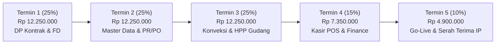

# BUSINESS REQUIREMENTS DOCUMENT (BRD) — EXECUTIVE VERSION
## SISTEM ERP & POS TERPADU MOTAAPP
**Spesifikasi Kebutuhan Bisnis Ringkas (Owner & Investor-Ready)**

---

### 📋 INFORMASI DOKUMEN
* **Kode Dokumen:** `BRD-MOTA-LITE-V1`
* **Klien / Stakeholder:** Pak Abrar (Owner MotaApp)
* **Partner Teknologi:** Xavortree Technology Partner
* **Lead Architect:** Dimitri Ahmad S. & Bang Ferry
* **Durasi Pengerjaan:** 120 Mandays (6 Bulan / 24 Minggu Kerja)
* **Total Nilai Investasi:** **Rp 49.000.000,00 All-In Turnkey** (Best Price Kemitraan)
* **Status:** Final & Siap Kick-Off

---

## 1. MASALAH SAAT INI & TARGET SOLUSI

| No | Titik Masalah (*Pain Point*) di Lapangan | Solusi Sistem Baru MotaApp |
| :---: | :--- | :--- |
| **1** | Kasir Android sering gagal sinkronisasi ke server web lama; closingan kasir manual di Excel rawan salah ketik. | Web POS kasir modern terintegrasi langsung ke database PostgreSQL pusat real-time. |
| **2** | Sistem lama mengunci input modal barang eksternal; HPP tidak ada sehingga laba kotor tidak pernah diketahui. | Penerapan baku: **1 Artikel = 1 HPP Flat**; selisih harga jual di toko otomatis jadi laba toko. |
| **3** | PO konveksi sering tertahan berlarut-larut tanpa tahu nyangkut di pos potong, jahit, steam, atau finishing mana. | Tracking 4 pos konveksi berjenjang dengan **Alarm Visual PO Merah** jika tertahan melebihi batas waktu. |
| **4** | Pembayaran transfer bank dicek manual lewat foto struk WA; rawan bukti transfer fiktif. | Integrasi **QRIS Dinamis & EDC Nontunai** dengan verifikasi sukses instan (<5 detik). |

---

## 2. KEPUTUSAN DESAIN UTAMA (PRINSIP NON-NEGOTIABLE)

1. **1 Artikel = 1 HPP Flat:** Satu nilai modal flat (bahan + ongkos produksi atau harga beli eksternal).
2. **4 Warna = 1 Artikel:** Variasi warna tidak dipecah jadi 4 SKU agar kasir dan stok opname cepat.
3. **Approval Sebelum PO:** Gudang hanya buat Purchase Request (PR); PO baru terbit setelah disetujui Pak Abrar/Finance.
4. **Mutasi Antar-Toko Langsung:** Toko A bisa langsung transfer stok ke Toko B tanpa lewat gudang pusat.
5. **Clean Database Cut-Off:** Database lama tidak di-clone; data historis lama diarsipkan terpisah.

---

## 3. TIGA ALUR DATA TERPADU

---

## 4. RUANG LINGKUP 10 MODUL UTAMA (25 EPIC)

1. **Modul 1: User & Access Management (Keycloak IAM):** Login SSO aman, menu dinamis 4 tabel master, hak akses fleksibel per role.
2. **Modul 2: Master Data Tekstil & Toko:** Artikel, Supplier bahan, Konveksi jahit, Toko cabang, Gudang, Satuan, Barcode label, dan konversi seri/pack.
3. **Modul 3: Procurement & Approval:** Purchase Request (PR), Approval Pak Abrar, PO Internal (ke konveksi) vs PO Eksternal (barang jadi luar).
4. **Modul 4: Produksi & Tracking 4 Stasiun:** Monitoring alur Potong $\rightarrow$ Jahit $\rightarrow$ Steam $\rightarrow$ Finishing/QC + Alert PO Merah (*anti-nyangkut*).
5. **Modul 5: Gudang, Inventori & HPP:** Inbound barang, input 1 HPP flat aktif, stock opname, penyesuaian selisih stok fisik.
6. **Modul 6: Distribusi Gudang $\rightarrow$ Toko:** Rencana distribusi, surat jalan, invoice hutang toko berbasis harga modal (HPP).
7. **Modul 7: Kasir Toko Grosir & Retail:** Grosir per seri/bundel, retail scan barcode satuan minimarket-style, struk belanja instan.
8. **Modul 8: Integrasi Pembayaran (EDC & QRIS):** QRIS dinamis, EDC, pencatatan kas tunai vs nontunai terpisah.
9. **Modul 9: Mutasi Stok Antar-Toko Langsung:** Transfer stok langsung antar gerai dengan validasi rule packing & auto-jurnal nilai aset.
10. **Modul 10: Finance & Executive Dashboard:** Auto-posting jurnal pembukuan, neraca, laba rugi, rekap kas closingan harian, dan layar pantau satu halaman untuk Pak Abrar.

---

## 5. ROADMAP KERJA 6 BULAN (120 MANDAYS) & 12 MILESTONE UTAMA

### 5.1 Tiga Pilar Eksekusi Strategis
* **Diskusi Requirement (37 Hari di Awal):** Wawancara mendalam & penyusunan Functional Document (FD) oleh Bang Ferry agar koding terarah.
* **Dual Environment:** Staging Sandbox (simulasi PO & pelatihan kasir) terpisah dari Production Live (transaksi komersial riil).
* **Piloting & Pendampingan 30 Hari:** Tim teknis standby mendampingi staf toko dan gudang langsung di Tanah Abang saat go-live.

### 5.2 Rincian 12 Milestone Utama Berbasis BAST

| ID | Modul / Milestone | Target Env | Durasi | PIC Utama | Output Kunci & Kriteria BAST |
| :---: | :--- | :---: | :---: | :---: | :--- |
| **M01** | **Kick-Off & Discovery FD** | Staging | 37 Hari | Bang Ferry & Lead PM | Dokumen FD disetujui & ditandatangani Pak Abrar. |
| **M02** | **Fondasi IAM & Keycloak** | Staging | 10 Hari | Backend Lead | Server SSO & Dynamic 4-Table RBAC teruji aktif. |
| **M03** | **Master Data Tekstil** | Staging | 14 Hari | Fullstack Dev | Master Artikel (4 warna 1 artikel), Supplier, Toko & Barcode. |
| **M04** | **Procurement PR & PO** | Staging | 18 Hari | Fullstack Dev | PR anggaran & dual approval gate Pak Abrar / Finance. |
| **M05** | **Tracking 4 Pos Konveksi** | Staging | 22 Hari | Lead Developer | Tracking Potong-Jahit-Steam-QC & Alert PO Merah (>14 hari). |
| **M06** | **Gudang & 1 HPP Flat** | Staging | 20 Hari | Backend Architect | Inbound barang, kotak input 1 HPP flat aktif & stock opname. |
| **M07** | **Distribusi Toko** | Staging | 14 Hari | Fullstack Dev | Perencanaan distribusi, surat jalan & invoice modal internal. |
| **M08** | **Kasir POS Web & QRIS** | Staging | 24 Hari | Frontend & Integrator | Web POS grosir seri, retail barcode & callback QRIS/EDC. |
| **M09** | **Mutasi Antar-Toko** | Staging | 12 Hari | Backend Dev | Transfer stok langsung antar gerai tanpa lewat gudang pusat. |
| **M10** | **Finance Auto-Journal** | Staging | 18 Hari | System Architect | Auto-posting jurnal, neraca, laba rugi & SBU profit toko. |
| **M11** | **Executive Dashboard** | Staging | 12 Hari | Frontend & Lead Dev | Satu layar pantau omzet multi-cabang, margin riil & stok slow. |
| **M12** | **QA, Cut-Off & Piloting (30d)** | Production Live | 20 Hari (30d Pilot) | All Team & Pak Abrar | Clean DB cut-off, sistem live di toko & serah terima 100% IP. |

---

## 6. ANGGARAN TURNKEY & 5 TERMIN RAMAH ARUS KAS

### Ringkasan Total Anggaran & Investasi

| Kategori | Komponen | Total (IDR) |
| :--- | :--- | :---: |
| **Base Project Value** | Turnkey Development 120 Mandays (All-In) | **49,000,000.00** |
| **Total Fee + Tax** | Termasuk Faktur Pajak Resmi (PPN 11%) | **54,390,000.00** |
| **Total OPEX (24 Bulan)** | Alokasi Cloud VPS & Managed Database | **4,200,000.00** |

#### Rincian Biaya Operasional Cloud (OPEX)
| Item | Tipe Layanan | Siklus | Monthly (IDR) | Total Fee (24 Bulan) |
| :--- | :--- | :---: | :---: | :---: |
| **Server Fee** | **Subscription Fee (+Tax)** | **Monthly** | **175,000.00** | **4,200,000.00** |

---

---

## 7. KRITERIA SERAH TERIMA & KEPEMILIKAN ASET
1. Seluruh 10 modul telah teruji di staging dan aktif beroperasi di server produksi.
2. Kasir toko terbukti dapat memproses penjualan seri grosir dan scan retail serta menerima pembayaran QRIS.
3. Laporan laba rugi dan posisi kas closingan terbentuk otomatis tanpa rekap manual.
4. **100% Hak Milik Source Code (IP Transfer)** diserahkan penuh kepada Pak Abrar tanpa royalti dan tanpa keterikatan lisensi vendor.
