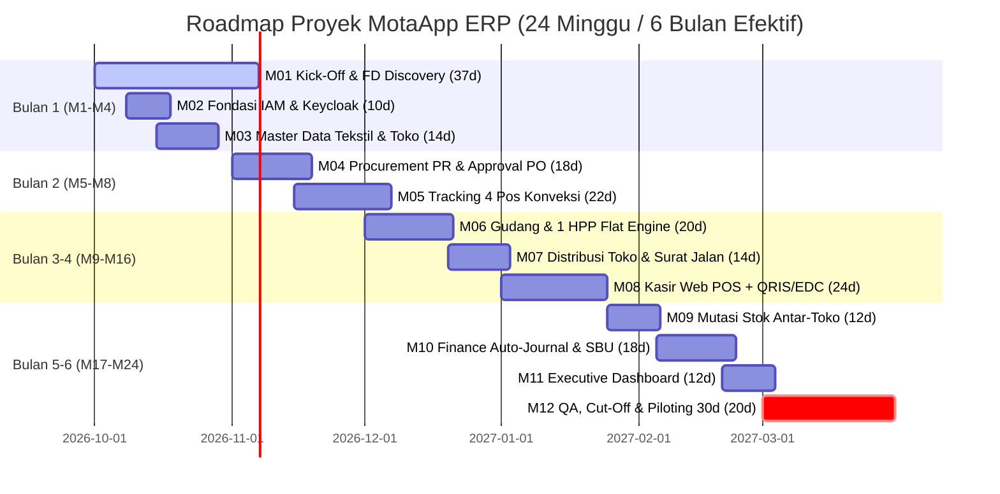
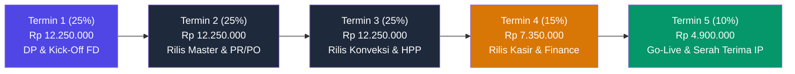

# DOKUMEN PENAWARAN RESMI & GRAND DESIGN SISTEM
## PENGEMBANGAN SISTEM ERP & POS TERPADU MOTAAPP
**Platform Enterprise Konveksi, Pergudangan Kain, Grosir/Retail Tanah Abang & Otomasi Keuangan**

---

### INFORMASI & KONTROL DOKUMEN

| Parameter | Keterangan Dokumen |
| :--- | :--- |
| **Judul Proyek** | Pengembangan Sistem ERP & POS Terpadu MotaApp |
| **Kode Dokumen** | `PKS-XV-MOTA-2026-V1` |
| **Versi Dokumen** | Versi 1.0 (Official Executive Proposal) |
| **Klien / Pemilik Usaha** | **Pak Abrar** (Owner MotaApp / Konveksi & Ritel Tekstil) |
| **Mitra Teknologi Pengembang** | **Xavortree Technology Partner** |
| **Lead Architect & PM** | Dimitri Ahmad S. & Bang Ferry |
| **Durasi Proyek** | 120 Mandays (6 Bulan / 24 Minggu Kerja Efektif) |
| **Nilai Kontrak Turnkey** | **Rp 49.000.000,00 All-In** *(Best Price Kemitraan Strategis)* |
| **Status Dokumen** | **FINAL FOR REVIEW & APPROVAL** |

---

## 1. RINGKASAN EKSEKUTIF & KONTEKS BISNIS

### 1.1 Latar Belakang & Realita Pasar Tanah Abang
Pasar tekstil dan garmen di Tanah Abang sedang mengalami pergeseran dinamika yang signifikan. Kenaikan biaya operasional dan sewa ruko tahunan yang tinggi (mencapai puluhan juta untuk kios ukuran 1.5 x 2m) di tengah pasar yang menantang menuntut pemilik usaha untuk:
1. Memaksimalkan perputaran barang cepat (*fast inventory turnover*) pada kanal **ritel satuan**.
2. Mengeliminasi kebocoran biaya produksi dan selisih stok manual.
3. Menyatukan proses bisnis yang saat ini masih terpecah antara web aplikasi lama, pencatatan kasir di HP Android, nota fisik, dan rekap spreadsheet Excel.

### 1.2 Masalah Sistem Lama (5 Tahun Monolitik)
Berdasarkan evaluasi langsung bersama Pak Abrar:
* **Fragmentasi Data:** Kasir di Android terpisah dari web server pusat; sinkronisasi sering gagal (*reconciliation issue*).
* **Selisih Stok & Human Error:** Kesalahan pencatatan manual di Excel rawan terjadi, mulai dari salah rumus hingga angka nol hilang satu yang mengubah nilai kas puluhan juta rupiah.
* **Ketiadaan HPP pada Barang Eksternal:** Sistem lama mengunci input modal untuk barang luar sehingga margin laba kotor tidak pernah bisa terbentuk.
* **PO Tertahan Tanpa Jejak:** Pemilik kesulitan mengetahui di stasiun mana pesanan konveksi sedang mandek (apakah di potong, jahit, steam, atau finishing).
* **Verifikasi Transfer Bank Manual:** Cek mutasi transfer manual menyita waktu dan berisiko bukti transfer fiktif.

### 1.3 Solusi MotaApp Baru dari Xavortree
Membangun platform ERP modern berbasis web terpusat yang menghubungkan hulu ke hilir:
$$\text{Pembelian Bahan} \longrightarrow \text{Tracking Konveksi} \longrightarrow \text{Gudang & 1 HPP Flat} \longrightarrow \text{Kasir Grosir/Retail} \longrightarrow \text{Auto Jurnal Finance}$$

---

## 2. KEPUTUSAN DESAIN UTAMA (PRINSIP NON-NEGOTIABLE)

1. **Prinsip 1 Artikel = 1 HPP Flat:**  
   HPP tidak dipecah per rincian tahapan jasa potong/jahit, melainkan diinput 1 nilai HPP flat saat barang jadi diterima di gudang (menggabungkan modal bahan + total ongkos produksi atau harga beli eksternal).
2. **Variasi Warna Tidak Dipecah SKU:**  
   4 variasi warna tetap dihitung sebagai **1 Artikel** tunggal. Ini menyederhanakan proses stock opname dan kecepatan transaksi kasir.
3. **Approval Wajib Mendahului PO:**  
   Gudang hanya berwenang membuat Purchase Request (PR). Uang tidak dapat keluar dan PO tidak dapat dikirim ke supplier sebelum disetujui Pak Abrar / Finance.
4. **Penyatuan Kasir Grosir & Retail:**  
   Alur kasir grosir (kelipatan seri/pack) dan retail (scan barcode satuan) disatukan dalam antarmuka web responsif yang ramah layar sentuh/tablet.
5. **Mutasi Antar-Toko Langsung (*Store-to-Store Transfer*):**  
   Toko A dapat langsung meminta transfer barang ke Toko B tanpa harus dipulangkan ke gudang pusat; jurnal nilai aset otomatis tercatat di modul Finance.
6. **Strategi Cut-Off Data Bersih (*Clean Database*):**  
   Database dibangun baru dan bersih tanpa meng-clone database lama yang sudah berantakan. Seluruh PO aktif lama diselesaikan terlebih dahulu sebelum sistem baru beroperasi.

---

## 3. TIGA ALUR INTI SISTEM (THREE CORE FLOWS)


---

## 4. RUANG LINGKUP 10 MODUL FUNGSIONAL & MATRIKS BACKLOG KERJA

Mengacu pada dokumen **MOTA - Grand Design (Phase 1 Effort Analysis)**, seluruh kebutuhan sistem dirumuskan ke dalam 10 Scope Fungsional dengan **65 Must-Have Backlog Items**:

### 4.1 Ringkasan 10 Pilar Modul
1. **Modul 1: User & Access Management (Keycloak IAM):** Otentikasi terpusat SSO, Dynamic 4-Table RBAC (`Menu`, `Role`, `Privilege`, `User`), proteksi nilai HPP sensitif.
2. **Modul 2: Master Data Terpadu Tekstil & Toko:** Master Artikel (4 Warna 1 Artikel), Master Supplier & Konveksi, Master Toko & Konversi Seri/Pack, Custom Barcode Generator.
3. **Modul 3: Procurement & Approval Gate:** Form Purchase Request (PR), Dual Approval Gate Pak Abrar, Penomoran PO Kronologis Otomatis, Percabangan PO Internal vs Eksternal.
4. **Modul 4: Produksi & Tracking 4 Pos Konveksi:** Tracking Potong $\rightarrow$ Jahit $\rightarrow$ Steam $\rightarrow$ QC, Alarm Visual PO Macet (>14 hari), Pemisahan Barang Pecah Seri ke eceran.
5. **Modul 5: Gudang, Inventori & 1 HPP Flat:** Inbound Bahan & Barang Jadi, Kotak Input 1 HPP Flat Wajib terisi sebelum barang keluar, Stock Opname, Stock Adjustment berizin.
6. **Modul 6: Distribusi Gudang $\rightarrow$ Toko:** Perencanaan distribusi cabang, Surat Jalan resmi, Invoice Internal Modal HPP (toko berhutang modal ke gudang).
7. **Modul 7: Kasir Penjualan Toko (Grosir & Retail):** Web POS Grosir (kelipatan pack), POS Retail Barcode scan satuan, Integrasi QRIS Dinamis & EDC Nontunai, Rekap Kasir Closing Laci.
8. **Modul 8: Mutasi Stok Antar-Toko Langsung (*Store-to-Store*):** Request transfer langsung toko-ke-toko tanpa lewat gudang pusat, validasi aturan pack, perpindahan stok atomik anti-selisih.
9. **Modul 9: Finance & Accounting (*Zero Manual Typing*):** Auto-Posting jurnal dari semua transaksi, Pemisahan SBU Toko (setor modal ke rekening induk, margin jadi laba toko), Neraca & Laba Rugi real-time.
10. **Modul 10: Executive Dashboard Satu Layar:** Omzet multi-cabang, gross profit riil, posisi kas laci, stok bergerak lambat (*slow-moving*), dan daftar PO merah nyangkut.

---

### 4.2 Matriks 65 Fitur Backlog Utama (Must-Have Work Breakdown)

| No | Modul / Scope | Epic & Fitur | Aktor | User Story & Nilai Bisnis | Prioritas |
| :---: | :--- | :--- | :---: | :--- | :---: |
| 1 | IAM | Setup Keycloak & SSO | Admin | Sebagai Admin, mengelola otentikasi aman terpusat agar akun staf terlindungi. | MUST |
| 2 | IAM | Dynamic RBAC (4 Tabel) | Admin | Mengatur hak akses menu dinamis per role tanpa perlu koding ulang. | MUST |
| 3 | IAM | User Management & Toko | Admin | Mengelompokkan user ke cabang toko atau gudang tertentu untuk isolasi data. | MUST |
| 4 | IAM | Sensitive Data Masking | Admin | Menyembunyikan nominal modal HPP dari staf kasir dan operator konveksi. | MUST |
| 5 | Master | Master Artikel & Seri | Admin | Input artikel baru (1 artikel mencakup 4 variasi warna tanpa pecah SKU). | MUST |
| 6 | Master | Master Supplier & Konveksi | Admin | Mendata pemasok bahan kain dan daftar mitra jahit binaan lengkap. | MUST |
| 7 | Master | Master Toko Cabang | Admin | Mendaftarkan profil gerai toko (Tanah Abang grosir vs retail satuan). | MUST |
| 8 | Master | Mapping Konversi Pack | Admin | Menentukan isi pcs per seri/pack untuk transaksi cepat di kasir grosir. | MUST |
| 9 | Master | Barcode Tag Generator | Gudang | Membuat dan mencetak stiker label barcode optik untuk pakaian fisik. | MUST |
| 10 | Master | Master Satuan Bahan | Admin | Mengelola satuan yard, roll, kilogram bahan kain dan aksesoris kancing/resleting. | MUST |
| 11 | Procurement | Form Purchase Request (PR) | Gudang | Membuat pengajuan pembelian bahan baku/barang jadi dengan justifikasi biaya. | MUST |
| 12 | Procurement | Approval Gate Owner | Pak Abrar | Menyetujui/menolak usulan PR sebelum dana keluar dan PO diterbitkan. | MUST |
| 13 | Procurement | Auto PO Number Generator | Admin | Penerbitan nomor PO berurutan otomatis tanpa duplikasi atau salah urutan tanggal. | MUST |
| 14 | Procurement | Percabangan Alur PO | Admin | Memisahkan PO kain (ke konveksi) vs PO barang jadi luar (langsung ke gudang). | MUST |
| 15 | Procurement | Ekspor PDF Resmi PO | Admin | Mencetak dokumen Purchase Order resmi berformat PDF untuk dikirim ke supplier. | MUST |
| 16 | Procurement | Audit Jejak Status PO | Finance | Melacak histori persetujuan dan perubahan kuantitas dari PR hingga PO terbit. | MUST |
| 17 | Produksi | Stasiun Potong (Cutting) | Operator | Mencatat yard kain yang dipotong dan hasil kuantitas potongan fisik (pisis). | MUST |
| 18 | Produksi | Stasiun Jahit (Sewing) | Operator | Menugaskan bundel potongan kain ke mitra konveksi jahit tertentu. | MUST |
| 19 | Produksi | Stasiun Steam (Setrika) | Operator | Mencatat progres pakaian yang telah disetrika uap dan dirapikan. | MUST |
| 20 | Produksi | Stasiun Finishing & QC | QC Staf | Memeriksa jahitan cacat (defect) dan memilah pakaian lolos standar. | MUST |
| 21 | Produksi | Stuck PO Alert (>14 Hari) | Owner | Sistem otomatis menandai nomor PO merah di dashboard bila tertahan di konveksi. | MUST |
| 22 | Produksi | Pemisahan Pecah Seri | Operator | Mengalihkan pakaian sisa ganjil yang tidak cukup 1 pack ke gerai ritel eceran. | MUST |
| 23 | Produksi | Kartu Monitoring Produksi | Operator | Lembar fisik/digital yang menyertai bundel kain di setiap tahapan pengerjaan. | MUST |
| 24 | Produksi | Rekap Ongkos Jahit Mitra | Finance | Menghitung total upah jahit per pisis yang harus dibayarkan ke konveksi mitra. | MUST |
| 25 | Gudang | Inbound Penerimaan Barang | Gudang | Menerima hasil konveksi atau pembelian luar dan mencocokkan fisik dengan PO. | MUST |
| 26 | Gudang | Input 1 HPP Flat Wajib | Gudang | Mengisi 1 nilai modal baku per artikel; wajib terisi sebelum barang keluar. | MUST |
| 27 | Gudang | Stock Card Digital | Gudang | Melihat mutasi keluar masuk persediaan per artikel secara kronologis. | MUST |
| 28 | Gudang | Stock Opname Berkala | Gudang | Melakukan perhitungan fisik stok di gudang dan membandingkan dengan data sistem. | MUST |
| 29 | Gudang | Stock Adjustment Berizin | Admin | Menyesuaikan selisih stok fisik dengan persetujuan Pak Abrar / Kepala Gudang. | MUST |
| 30 | Gudang | Alert Stok Minimum Kain | Gudang | Peringatan otomatis jika bahan baku kain di gudang tersisa di bawah batas aman. | MUST |
| 31 | Gudang | Multi-Lokasi Bin Rak | Gudang | Menandai lokasi penyimpanan roll kain di rak gudang agar mudah dicari. | MUST |
| 32 | Distribusi | Jadwal Distribusi Cabang | Logistik | Merencanakan alokasi pengiriman barang dari gudang ke toko grosir/retail. | MUST |
| 33 | Distribusi | Penerbitan Surat Jalan | Logistik | Mencetak surat jalan resmi dengan rincian seri/pack dan nomor segel barang. | MUST |
| 34 | Distribusi | Konfirmasi Terima Toko | Kasir | Staf toko memverifikasi fisik barang masuk dan menekan konfirmasi penerimaan. | MUST |
| 35 | Distribusi | Invoice Internal Modal HPP | Finance | Otomasi pencatatan hutang modal toko ke gudang berdasarkan nilai HPP. | MUST |
| 36 | Distribusi | Laporan Selisih Kirim | Logistik | Mencatat selisih jika barang yang diterima toko kurang/rusak saat di perjalanan. | MUST |
| 37 | Kasir | Web POS Grosir (Pack Seri) | Kasir | Menjual pakaian kelipatan seri/pack dengan pemotongan stok otomatis per pisis. | MUST |
| 38 | Kasir | Web POS Retail (Barcode) | Kasir | Menjual satuan dengan scan barcode optik cepat tanpa antrean panjang. | MUST |
| 39 | Kasir | Integrasi QRIS Dinamis API | Kasir | Menampilkan QRIS di layar; transaksi lunas otomatis terverifikasi <5 detik. | MUST |
| 40 | Kasir | Integrasi EDC Nontunai | Kasir | Pencatatan pembayaran kartu debit/kredit via mesin EDC dengan auto-callback. | MUST |
| 41 | Kasir | Cetak Struk Nota Belanja | Kasir | Mencetak bukti struk pembayaran thermal instan untuk pelanggan. | MUST |
| 42 | Kasir | Rekap Closing Kasir Laci | Kasir | Menghitung uang kas awal, omzet tunai, QRIS, kasbon dan fisik uang laci. | MUST |
| 43 | Kasir | Pengeluaran Kasbon Harian | Kasir | Mencatat pengeluaran kas operasional kecil toko (makan siang, solasi, bensin). | MUST |
| 44 | Kasir | Penahanan Keranjang Belanja | Kasir | Fitur hold/resume transaksi jika pembeli ingin menambah barang lain. | MUST |
| 45 | Kasir | Diskon Manual Berizin | Kasir | Memberikan potongan harga khusus pelanggan grosir dengan otorisasi PIN. | MUST |
| 46 | Kasir | Retur Barang Rusak Toko | Kasir | Memproses pengembalian pakaian defect dari pembeli dengan bukti nota. | MUST |
| 47 | Kasir | Mode Transaksi Kasir Tablet | Kasir | Antarmuka responsif layar sentuh yang ringan dijalankan di tablet / laptop toko. | MUST |
| 48 | Kasir | Multi Kasir dalam 1 Toko | Kasir | Mendukung operasional 2 meja kasir bersamaan di toko ramai Tanah Abang. | MUST |
| 49 | Mutasi | Request Transfer Toko | Kepala Toko | Toko A yang kekurangan stok meminta barang langsung ke Toko B tanpa gudang. | MUST |
| 50 | Mutasi | Pengecekan Stok Toko Asal | Kepala Toko | Melihat sisa ketersediaan barang di toko sumber sebelum mengajukan transfer. | MUST |
| 51 | Mutasi | Validasi Aturan Pack | Sistem | Menolak mutasi jika toko sumber meminta jumlah ganjil di luar kelipatan pack. | MUST |
| 52 | Mutasi | Pengiriman Stok Atomic DB | Sistem | Memindahkan stok seketika tanpa risiko stok hilang mengambang di database. | MUST |
| 53 | Mutasi | Update Piutang Cabang | Finance | Memindahkan beban hutang modal HPP dari Toko Asal ke Toko Peminta otomatis. | MUST |
| 54 | Finance | Auto-Posting Transaksi | Sistem | Pembelian, pengiriman, penjualan dan mutasi otomatis membentuk jurnal buku besar. | MUST |
| 55 | Finance | Pemisahan SBU Margin Toko | Finance | Toko setor modal ke rekening induk; margin harga jual tetap jadi profit toko. | MUST |
| 56 | Finance | Buku Besar & Jurnal Umum | Akuntan | Melihat riwayat debet/kredit otomatis tanpa perlu entry manual di spreadsheet. | MUST |
| 57 | Finance | Rekonsiliasi Bank Otomatis | Finance | Mencocokkan setoran omzet kasir dan QRIS dengan rekening koran perbankan. | MUST |
| 58 | Finance | Laporan Laba Rugi Komprehensif | Owner | Melihat pendapatan kotor, HPP riil, biaya operasional, dan laba bersih per periode. | MUST |
| 59 | Finance | Laporan Neraca Keuangan | Owner | Menampilkan posisi aset lancar (kas, persediaan kain/baju) vs hutang usaha. | MUST |
| 60 | Finance | Monitoring Hutang Usaha (AP) | Finance | Memantau jatuh tempo pembayaran bahan kain ke pemasok eksternal. | MUST |
| 61 | Finance | Monitoring Piutang Pelanggan | Finance | Mengontrol piutang pembeli langganan grosir yang membayar dengan tempo. | MUST |
| 62 | Dashboard | Grafik Omzet Harian Multi-Toko | Owner | Memantau performa penjualan gerai grosir vs gerai retail dalam 1 layar visual. | MUST |
| 63 | Dashboard | Gross Profit Bersih Riil | Owner | Mengetahui laba kotor riil (omzet dikurangi 1 HPP Flat modal) per hari. | MUST |
| 64 | Dashboard | Alert Stok Kain Lambat Bergerak | Owner | Memantau stok roll kain atau pakaian yang tidak laku >60 hari (slow-moving). | MUST |
| 65 | Dashboard | Akses Dashboard Smartphone | Owner | Pak Abrar dapat memantau seluruh indikator bisnis dari HP di mana saja. | MUST |

---

## 5. ROADMAP PELAKSANAAN 6 BULAN (120 MANDAYS) & TABEL 12 MILESTONE UTAMA

### 5.1 Tiga Prinsip Eksekusi Strategis (Anti-Gagal Operasional)
1. **Diskusi Kebutuhan (37 Hari Paralel di Awal):**  
   Penyusunan *Functional Document (FD)* komprehensif oleh Lead Architect & System Analyst (Bang Ferry) sebelum koding dimulai, memastikan tidak ada fitur yang "ngawang" dan alur konveksi/gudang terdefinisi sempurna.
2. **Arsitektur Dual Environment (Staging Sandbox vs Production Live):**  
   Environment **Staging (Sandbox)** disediakan khusus untuk uji coba rolling PO, simulasi mutasi antar-toko, dan pelatihan kasir tanpa mengganggu operasional. Environment **Production (Live)** terisolasi steril untuk transaksi komersial harian.
3. **Piloting & Pendampingan Langsung 30 Hari di Tanah Abang:**  
   Tim teknis Xavortree hadir langsung mendampingi kasir toko dan staf gudang saat cut-off data bersih dilakukan dan sistem mulai menerima transaksi fisik nyata.

---

### 5.2 Pembagian Periode Kerja 6 Bulan (24 Minggu Efektif)



---

### 5.3 Rincian 12 Milestone Utama, Durasi Mandays, Deliverables & Kriteria BAST

| ID | Modul / Milestone | Deliverables Kunci | Target Env | Durasi | PIC Utama | Kriteria Penerimaan BAST |
| :---: | :--- | :--- | :---: | :---: | :---: | :--- |
| **M01** | **Kick-Off & Discovery FD** | Dokumen Fungsional (FD) detail, alur konveksi 4 pos, aturan 1 HPP Flat & struktur 4 tabel RBAC. | Staging | 37 Hari | Bang Ferry & Lead Architect | Dokumen FD disetujui & ditandatangani Pak Abrar. |
| **M02** | **Fondasi IAM & Keycloak** | Server Keycloak SSO aktif, tabel `Menu`, `Role`, `Privilege`, `User` dinamis, token JWT secure. | Staging | 10 Hari | Backend Lead | Staf login terisolasi, menu tampil sesuai privilege role. |
| **M03** | **Master Data Tekstil** | Master Artikel (4 warna 1 artikel), Master Supplier & Konveksi, Master Toko, Mapping Pack, Barcode. | Staging | 14 Hari | Fullstack Dev | Data kain, toko & artikel bisa diinput, barcode terbit. |
| **M04** | **Procurement PR & PO** | Form PR estimasi biaya, dual approval Pak Abrar/Finance, auto PO chronological, branch internal/eksternal. | Staging | 18 Hari | Fullstack Dev | Uang tidak bisa keluar tanpa approval, PO resmi terbit. |
| **M05** | **Tracking 4 Pos Konveksi** | Tracking Potong-Jahit-Steam-QC, alarm visual PO macet merah (>14 hari), pemisahan barang pecah seri. | Staging | 22 Hari | Lead Developer | Pergerakan kuantitas terpantau, alert merah muncul. |
| **M06** | **Gudang & 1 HPP Flat** | Inbound penerimaan barang, input 1 HPP Flat aktif (wajib isi), stock card digital, stock opname & adj. | Staging | 20 Hari | Backend Architect | Barang tidak bisa keluar tanpa HPP flat terisi valid. |
| **M07** | **Distribusi Toko** | Perencanaan alokasi cabang, cetak surat jalan resmi, konfirmasi terima toko, invoice modal internal. | Staging | 14 Hari | Fullstack Dev | Toko terima barang dan tercatat hutang modal ke gudang. |
| **M08** | **Kasir POS Web & QRIS** | Web POS Grosir seri/pack, POS Retail barcode scan, QRIS dinamis API & EDC nontunai callback, closing kas laci. | Staging | 24 Hari | Frontend & Integrator | Transaksi scan lancar, QRIS verifikasi lunas <5 detik. |
| **M09** | **Mutasi Antar-Toko** | Request transfer toko langsung tanpa gudang, validasi aturan pack, perpindahan stok atomik anti-selisih. | Staging | 12 Hari | Backend Dev | Stok Toko A pindah ke Toko B, piutang modal terupdate. |
| **M10** | **Finance Auto-Journal** | Auto-posting jurnal debet/kredit, pemisahan margin SBU toko vs induk, neraca & laba rugi real-time. | Staging | 18 Hari | System Architect | Laporan rugi laba terbit otomatis tanpa ketik Excel. |
| **M11** | **Executive Dashboard** | Dashboard omzet multi-cabang, gross profit riil, posisi kas laci, stok bergerak lambat (*slow-moving*). | Staging | 12 Hari | Frontend & Lead Dev | Tampil responsif di laptop & smartphone Pak Abrar. |
| **M12** | **QA, Cut-Off & Piloting** | UAT komprehensif, penyelesaian PO lama (*clean cut-off*), pelatihan staf & pendampingan 30 hari Tanah Abang. | Production Live | 20 Hari (30d Pilot) | All Team & Pak Abrar | Sistem 100% live di toko, BAST akhir & penyerahan source code IP. |

---

---

## 6. STRUKTUR INVESTASI BIAYA & SKEMA TERMIN

### 6.1 Ringkasan Total Anggaran & Investasi

| Kategori | Komponen | Total (IDR) | Keterangan |
| :---: | :--- | :---: | :--- |
| **INVESTASI INTI** | **Base Project Value** | **Rp 49.000.000,00** | Turnkey Development 120 Mandays (All-In) |
| **PAJAK RESMI** | **Total Fee + Tax (PPN 11%)** | **Rp 54.390.000,00** | Termasuk Faktur Pajak resmi (PPN Rp 5.390.000,00) |
| **OPEX CLOUD** | **Total OPEX (24 Bulan)** | **Rp 4.200.000,00** | Alokasi Server & Database Cloud selama 24 bulan penuh |

---

### 6.2 Rincian Biaya Operasional Cloud (OPEX 24 Bulan)

Untuk menjamin uptime server transaksi kasir dan sinkronisasi konveksi toko Tanah Abang berjalan tanpa interupsi infrastruktur:

| Item | Tipe Layanan | Siklus Penagihan | Biaya Bulanan (IDR) | Total Fee (24 Bulan) |
| :--- | :--- | :---: | :---: | :---: |
| **Server Fee** | **Subscription Fee (+Tax)** | **Monthly** | **Rp 175.000,00** | **Rp 4.200.000,00** |

*Catatan OPEX:* Dialokasikan untuk sewa Cloud VPS dedicated + Managed Database PostgreSQL/MySQL berkinerja tinggi beserta auto-backup berkala selama 2 tahun penuh.

---

### 6.3 Rincian Komponen Mandays Base Project Value (Formula Pricelist)

| No | Komponen Pembiayaan | Volume / Mandays | Rate Satuan (IDR) | Total Biaya (IDR) |
| :---: | :--- | :---: | :---: | :---: |
| 1 | **Project Manager & Lead Architect** | 120 Mandays | Rp 150.000 / hari | Rp 18.000.000,00 |
| 2 | **Fullstack Developer & Technical Lead** | 120 Mandays | Rp 150.000 / hari | Rp 18.000.000,00 |
| 3 | **Server & Database Cloud Setup Fee** | 1 Kali Awal | Rp 1.000.000 (Setup) | Rp 1.000.000,00 |
| 4 | **Service Fee (Agile, QA & UAT Hardening)**| 120 Mandays | Rp 100.000 / hari | Rp 12.000.000,00 |
| **TOTAL** | **NILAI INVESTASI TURNKEY DEVELOPMENT (ALL-IN)** | | | **Rp 49.000.000,00** |

---

### 6.4 Skema 5 Termin Pembayaran Ramah Arus Kas (BAST-Driven)
Untuk menjamin arus kas operasional toko Pak Abrar tetap aman dan lancar selama masa pembangunan sistem:



* **Termin 1 (25% — Rp 12.250.000,00):** Uang Muka (DP) Penandatanganan Kontrak, Finalisasi FD Detail & Setup Keycloak IAM.
* **Termin 2 (25% — Rp 12.250.000,00):** Penyelesaian Modul 1 & 2 (Master Data Artikel, Supplier, Toko) serta Modul 3 (Procurement PR & Approval PO).
* **Termin 3 (25% — Rp 12.250.000,00):** Penyelesaian Modul 4 (Tracking Konveksi) serta Modul 5 & 6 (Gudang, 1 HPP Flat & Distribusi Toko).
* **Termin 4 (15% — Rp 7.350.000,00):** Penyelesaian Modul 7 & 8 (Kasir POS QRIS/EDC, Mutasi Antar Toko) dan Modul 9-10 (Auto-Jurnal Finance & Dashboard).
* **Termin 5 (10% — Rp 4.900.000,00):** UAT Final tuntas, migrasi cut-off data lama, pelatihan staf kasir/gudang, dan serah terima 100% Hak Milik Source Code.

---

## 7. NILAI TAMBAH & KOMITMEN KEMITRAAN

1. **100% Hak Kekayaan Intelektual (Source Code IP Transfer):**  
   Pak Abrar memegang kepemilikan penuh atas kode program, skema database, dan dokumentasi API. Bebas royalti dan tanpa ketergantungan vendor (*No Vendor Lock-in*).
2. **Kustomisasi Khusus Sesuai Karakter Tanah Abang:**  
   Bukan aplikasi instan kaku (*SaaS massal*) yang memaksa Pak Abrar mengubah cara kerja. Sistem dirancang mengikuti ritme grosir dan retail pakaian nyata di lapangan.
3. **Peluang White-Label & Kemitraan Komunitas:**  
   Sebagai tokoh pedagang di Tanah Abang, jika rekan-rekan bisnis Pak Abrar tertarik mengadopsi platform ini, terbuka skema kemitraan lisensi bersama yang saling menguntungkan.
4. **Garansi Pemeliharaan:**  
   Garansi perbaikan bug dan pendampingan operasional selama **60 Hari Kalender** pasca *Go-Live*.

---

## 8. LEMBAR PERSETUJUAN & PENGESAHAN

Dengan menandatangani dokumen ini, kedua belah pihak menyatakan sepakat atas ruang lingkup, jadwal pelaksanaan, dan struktur investasi sistem ERP MotaApp.

<br>

```
Disahkan di Jakarta pada Tanggal: ........................................... 2026
```

<br>

| PIHAK KLIEN & PEMILIK USAHA | PIHAK PENGEMBANG TEKNOLOGI |
| :---: | :---: |
| **MOTAAPP INDONESIA** | **XAVORTREE TECHNOLOGY PARTNER** |
| <br><br><br><br> | <br><br><br><br> |
| **( PAK ABRAR )** | **( DIMITRI AHMAD S. )** |
| Business Owner & Principal | Lead Partner & Solutions Architect |
