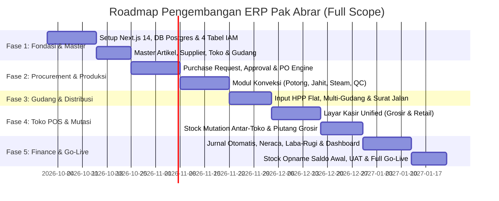

# 📄 PRODUCT REQUIREMENTS DOCUMENT (PRD) — FULL SCOPE
## ERP PAK ABRAR — Sistem Terintegrasi End-to-End (Konveksi, Gudang, Toko Grosir/Retail & Finance)
**Klien / Stakeholder:** Pak Abrar  
**Disusun Oleh:** Tim Xavortree  
**Basis Dokumen:** Helikopter View & UML Activity Diagram (Revisi 3)  
**Versi Dokumen:** 1.0.0 (Draft Bedah Kebutuhan & Open Items)  
**Status:** In Review & Team Follow-up  
**Platform Target:** Web-Based ERP & POS Responsive (Desktop 1440px Priority + Tablet POS)  
**Security & IAM:** Dynamic RBAC (4 Tabel Master: User, Role, Privilege, Menu)  

---

## 1. Executive Summary & Visi Produk

Sistem **ERP Pak Abrar** adalah platform enterprise terpadu yang menghubungkan seluruh rantai nilai bisnis dari hulu ke hilir:
$$\text{Master Data} \longrightarrow \text{Procurement} \longrightarrow \text{Produksi (Konveksi)} \longrightarrow \text{Gudang} \longrightarrow \text{Toko (Grosir/Retail)} \longrightarrow \text{Finance} \longrightarrow \text{Reporting}$$

Sistem ini dirancang untuk mengatasi inefisiensi pencatatan manual di Excel, mengeliminasi selisih stok, serta mengotomatisasi pencatatan keuangan (*zero manual input* untuk jurnal transaksi operasional).

### 1.1 Tiga Alur Inti yang Wajib Dilacak (Three Core Flows)
1. **Document Flow (Alur Dokumen):**  
   Perjalanan dokumen legal dan operasional:  
   $$\text{Purchase Request (PR)} \longrightarrow \text{Approval Owner/Finance} \longrightarrow \text{Purchase Order (PO)} \longrightarrow \text{Surat Jalan / Nota Terima} \longrightarrow \text{Invoice Toko} \longrightarrow \text{Kuitansi Pelunasan}$$
2. **Quantity Flow (Alur Fisik Kuantitas):**  
   Perjalanan fisik bahan dan barang jadi di setiap stasiun kerja konveksi hingga gerai toko:  
   $$\text{Bahan Baku} \longrightarrow \text{Potong} \longrightarrow \text{Jahit} \longrightarrow \text{Steam} \longrightarrow \text{Finishing/QC} \longrightarrow \text{Stok Gudang Jadi} \longrightarrow \text{Stok Toko}$$
3. **Value Flow (Alur Nilai Uang & Aset):**  
   Pencatatan pergerakan nilai kapital dan perubahan neraca aktiva:  
   $$\text{Kas/Hutang Pembelian} \longrightarrow \text{HPP Artikel Flat} \longrightarrow \text{Piutang Gudang ke Toko (Harga Modal)} \longrightarrow \text{Omset Toko} \longrightarrow \text{Kas & Laba-Rugi}$$

---

## 2. Keputusan Desain yang Sudah Final (Non-Negotiable)

Berdasarkan kesepakatan final bersama Pak Abrar:
1. **Variasi Warna Tidak Didetailkan:**  
   4 variasi warna tetap dihitung sebagai **1 Artikel** tunggal (tidak dipecah SKU per warna). Ini menyederhanakan proses stock opname dan input kasir.
2. **1 Artikel = 1 HPP Flat:**  
   HPP tidak dipecah per rincian tahapan produksi internal, melainkan diinput 1 nilai HPP flat saat barang jadi diterima di gudang sebelum didistribusikan ke toko.
3. **Penyatuan Flow Toko Grosir & Retail:**  
   Alur bisnis toko grosir dan retail disatukan dalam satu antarmuka kasir yang sama. Perbedaannya hanya terletak pada parameter data penjualan (Grosir = per seri/bundel; Retail = satuan scan barcode).
4. **Mutasi Stok Antar-Toko Langsung:**  
   Transfer stok antar toko (*store-to-store transfer*) berjalan langsung tanpa melalui gudang pusat, namun perpindahan nilai asetnya otomatis tercatat di sistem Finance.
5. **Approval Wajib Mendahului PO:**  
   Purchase Request (PR) dari bagian gudang wajib mendapatkan persetujuan (*approval*) dari Finance / Pak Abrar sebelum PO resmi dapat diterbitkan ke supplier.
6. **Strategi Cut-Off Data Lama:**  
   Database dibangun ulang bersih (*clean database*). Data historis lama disimpan terpisah hanya sebagai arsip/laporan komparasi (tidak di-clone langsung). Seluruh PO aktif lama wajib diselesaikan sebelum *go-live*.
7. **Cakupan Penuh Sekaligus (*Full Scope*):**  
   Pengembangan dilakukan langsung untuk seluruh modul terpadu sesuai instruksi eksplisit Pak Abrar (bukan rilis bertahap/MVP parsial).

---

## 3. Matriks Hak Akses CRUD & Approval (Role-Based Access Control)

Arsitektur IAM menggunakan model dinamis 4 tabel master (`Menu`, `Role`, `Privilege`, `User` + tabel relasi `Role_Menu_Privilege`).

| Modul / Fitur | Kode | Super Admin (Pak Abrar) | Gudang | Produksi (Konveksi) | Toko (Grosir/Retail) | Finance & Accounting |
|---|---|:---:|:---:|:---:|:---:|:---:|
| **Master Data: Artikel, Toko, User, Menu** | F1-A1 | V, C, U, D | V, C, U | V | V | V |
| **Master Data: Supplier & Konveksi** | F1-A2 | V, C, U, D | V, C, U | - | - | V |
| **Purchase Request (PR) Bahan/Barang** | F2-A1 | V, U, App | V, C, U | - | - | V, U, App |
| **Approval PR & Penerbitan PO** | F2-A2 | V, C, App | V (View PO) | - | - | V, C, App |
| **Penerimaan Bahan & Nota Supplier** | F2-A3 | V | V, C, U | V | - | V |
| **Assign SPK / PO ke Jalur Produksi** | F3-A1 | V | V, C | V | - | - |
| **Tracking Progres: Potong, Jahit, Steam, QC**| F3-A2 | V | V | V, U | - | - |
| **Penerimaan Barang Jadi & Input HPP Flat** | F4-A1 | V, U | V, C, U | V | - | V, U |
| **Distribusi Barang ke Toko (Invoice Modal)**| F4-A2 | V | V, C, DL | - | V (Terima) | V |
| **Kasir Penjualan Retail (Scan Barcode)** | F5-A1 | V, DL | - | - | V, C, P | V |
| **Penjualan Grosir (Seri / Bundel)** | F5-A2 | V, DL | - | - | V, C, P | V |
| **Pencatatan Piutang & Cicilan Grosir** | F5-A3 | V, DL | - | - | V, C, U | V, U |
| **Request & Approval Transfer Stok Antar-Toko**| F6-A1 | V | - | - | V, C, U (App) | V (Jurnal Aset) |
| **Pelunasan Hutang Toko ke Gudang (HPP)** | F7-A1 | V, App | V | - | V | V, C, U |
| **Kas, Neraca, Laba-Rugi & Jurnal Otomatis** | F7-A2 | V, DL | - | - | - | V, C, U, DL |

*Keterangan: V = View, C = Create, U = Update, D = Delete, App = Approval / Otorisasi, P = Print Nota, DL = Download Laporan.*

---

## 4. Bedah Ruang Lingkup Spesifikasi per Modul

---

### MODUL 1: MASTER DATA & ENGINE IAM DINAMIS (F1)
* **User Story:** Sebagai Super Admin, saya ingin mengatur menu dan wewenang aksi tiap staf secara fleksibel tanpa perlu merombak kode program.
* **Fitur Utama:**
  - **F1.1 Dynamic Sidebar & RBAC:** Manajemen menu hirarkis (*parent-child*), mapping hak akses (*view, create, update, delete, approval*).
  - **F1.2 Master Artikel Terpadu:** Pengaturan kode artikel, nama, kategori, barcode, ukuran/size, satuan, dan tipe (Internal vs Eksternal).
  - **F1.3 Master Toko & PIC:** Pengaturan identitas toko/cabang, tipe (Grosir/Retail), lokasi alamat, serta penugasan PIC/Owner per toko.
  - **F1.4 Master Gudang & Konveksi:** Profil lokasi gudang penyimpanan serta data mitra konveksi.

---

### MODUL 2: PROCUREMENT, PURCHASE REQUEST & APPROVAL (F2)
* **User Story:** Sebagai Kepala Gudang, saya ingin merencanakan kebutuhan bahan baku dan mengajukan PR agar disetujui Finance sebelum PO dikirim ke Supplier.
* **Fitur Utama:**
  - **F2.1 Form Purchase Request (PR):** Input estimasi kebutuhan bahan/barang jadi dengan justifikasi operasional.
  - **F2.2 Dual Approval Engine:** Validasi kelayakan anggaran oleh Finance dan otorisasi akhir oleh Pak Abrar. Status: `Draft` $\rightarrow$ `Pending Approval` $\rightarrow$ `Approved` / `Rejected`.
  - **F2.3 Routing Tipe Pengadaan (PO):**
    - **Tipe Internal:** Pengadaan bahan mentah (kain, benang, kancing) yang akan diarahkan ke jalur konveksi (Modul 3).
    - **Tipe Eksternal:** Pengadaan barang jadi langsung dari supplier pihak ketiga yang langsung masuk ke gudang barang jadi (Modul 4).
  - **F2.4 Penerimaan Bahan & Pencatatan Nota Pengiriman:** Validasi kuantitas fisik datang vs PO dengan toleransi selisih.

---

### MODUL 3: PRODUKSI KONVEKSI & STAGE TRACKING (F3)
* **User Story:** Sebagai Penanggung Jawab Konveksi, saya ingin memperbarui progres pengerjaan barang di setiap pos produksi secara realtime.
* **Fitur Utama:**
  - **F3.1 Job Order / SPK Konveksi:** Penerbitan perintah kerja berdasarkan PO bahan baku internal yang telah diterima.
  - **F3.2 Stage Quantity Tracking (4 Tahapan Kerja):**
    $$\text{1. Potong (Cutting)} \longrightarrow \text{2. Jahit (Sewing)} \longrightarrow \text{3. Steam (Ironing/Press)} \longrightarrow \text{4. Finishing \& QC}$$
  - **F3.3 Monitoring Output per Pos:** Sistem hanya memantau kuantitas barang lolos vs *reject/afkir* pada setiap pos (tanpa perhitungan biaya per stasiun kerja).
  - **F3.4 Serah Terima Barang Jadi:** Pengiriman barang lolos QC ke Gudang Pusat disertai dokumen Berita Acara Serah Terima (BAST).

---

### MODUL 4: GUDANG, HPP FLAT & DISTRIBUSI TOKO (F4)
* **User Story:** Sebagai Staf Gudang, saya ingin menginput HPP flat saat barang tiba dan mengirimkannya ke toko dengan nota pengiriman resmi.
* **Fitur Utama:**
  - **F4.1 Input Wajib HPP Flat:** Sebelum barang didistribusikan, admin gudang wajib menginput 1 nilai HPP flat per artikel (menggabungkan biaya bahan + ongkos konveksi borongan).
  - **F4.2 Manajemen Stok Fisik Multi-Lokasi:** Tabel stok transaksional terpisah dari master artikel untuk mendukung multi-gudang dan cabang.
  - **F4.3 Surat Jalan Distribusi ke Toko:** Penerbitan invoice mutasi gudang ke toko. Nilai barang yang dikirim otomatis tercatat sebagai **Hutang Toko ke Gudang berbasis Harga Modal (HPP)**.
  - **F4.4 Stock Opname Gudang:** Penyesuaian stok berkala dengan pencatatan selisih dan persetujuan supervisor.

---

### MODUL 5: KASIR PENJUALAN TOKO GROSIR & RETAIL (F5)
* **User Story:** Sebagai Kasir Toko, saya ingin memproses transaksi pelanggan grosir maupun eceran secara cepat dalam satu layar kasir.
* **Fitur Utama:**
  - **F5.1 Unified POS Terminal:**
    - **Mode Retail:** Input cepat scan barcode USB/kamera, penjualan satuan, kalkulasi kembalian tunai/QRIS.
    - **Mode Grosir:** Penjualan per paket seri/bundel (otomatis memotong stok sejumlah pengali isi bundel), penetapan termin jatuh tempo.
  - **F5.2 Validasi Kecukupan Stok Toko:** Peringatan otomatis jika stok toko menipis, dengan opsi langsung membuka formulir request transfer ke toko lain.
  - **F5.3 Piutang Pelanggan Grosir:** Buku pembantu piutang, jadwal jatuh tempo, dan pencatatan angsuran bertahap beserta bukti bayar.
  - **F5.4 Integrasi Cetak Struk:** Driver cetak thermal Bluetooth / USB ESC-POS 58mm/80mm untuk struk belanja pelanggan.

---

### MODUL 6: TRANSFER STOK ANTAR-TOKO (STORE-TO-STORE MUTATION) (F6)
* **User Story:** Sebagai Kasir Toko Peminta, saya ingin meminta stok dari toko lain yang berlebih tanpa harus menunggu alokasi gudang pusat.
* **Fitur Utama:**
  - **F6.1 Visibilitas Stok Lintas Toko:** Cek ketersediaan artikel di toko cabang terdekat.
  - **F6.2 Request Mutasi & Verifikasi Packing:** Toko peminta membuat permintaan; toko pengirim memvalidasi fisik barang dan aturan packing seri sebelum menyetujui (*approval*).
  - **F6.3 Pemotongan Stok Dua Arah:** Pengurangan stok di toko pengirim dan penambahan di toko peminta secara sinkron.
  - **F6.4 Jurnal Otomatis Perpindahan Aset:** Nilai modal barang yang berpindah otomatis memutasikan saldo persediaan antar-toko di modul Finance.

---

### MODUL 7: FINANCE, ACCOUNTING & REKONSILIASI (F7)
* **User Story:** Sebagai Tim Finance & Pak Abrar, saya ingin melihat kondisi keuangan, kas, dan laba-rugi yang terbentuk otomatis dari transaksi operasional harian.
* **Fitur Utama:**
  - **F7.1 Integrasi Penjualan & Piutang Toko:** Seluruh omset kasir dan piutang pelanggan tercatat otomatis ke buku besar kas/bank dan piutang dagang.
  - **F7.2 Pelunasan Hutang Toko ke Gudang:** Perhitungan margin laba kotor dihitung dari selisih omset jual toko dikurangi pelunasan modal HPP ke gudang.
  - **F7.3 Rekonsiliasi Kas Shift & Biaya Toko:** Pencocokan kas penutupan shift kasir (*closing dana*) dikurangi pengeluaran operasional toko.
  - **F7.4 Dashboard Eksekutif Pak Abrar:** Grafik omset harian, nilai total aset persediaan, piutang jatuh tempo, laporan laba-rugi, dan neraca saldo *real-time*.

---

## 5. Checklist Kebutuhan yang Belum Ada (Open Items / TBD untuk Tim)

Bagian ini merinci poin-poin yang masih kosong atau memerlukan konfirmasi dari tim teknis, tim operasional, maupun Pak Abrar sebelum desain database dan UI dikunci.

```
┌───────────────────────────────────────────────────────────────────────────────────┐
│              CHECKLIST ACTION ITEMS & FOLLOW-UP UNTUK TIM INTERNAL                │
└───────────────────────────────────────────────────────────────────────────────────┘
```

### 🔴 Kategori 1: Master Data & Entitas Bisnis (Prioritas Tinggi)
- [ ] **Definisi Supplier Baku (Slide 4 & 17):**
  - *Deskripsi Masalah:* Saat ini masih terdapat 3 penafsiran berbeda tentang supplier.
  - *Pilihan yang Perlu Dipilih:*
    - **Opsi A:** Supplier murni penyedia bahan baku eksternal (kain, kancing, benang) dan barang jadi eksternal.
    - **Opsi B:** Supplier mencakup mitra toko konsinyasi/titipan.
    - **Opsi C:** Supplier mencakup pihak ketiga pemberi order maklon (*referral*).
  - *PIC Follow-up:* `[ .................... ]` | *Target Selesai:* `[ ... / ... / 2026 ]`
- [ ] **Data Kapasitas Mitra Konveksi (Slide 4 & 17):**
  - *Deskripsi Masalah:* Tim belum memiliki format data kapasitas riil untuk konveksi rekanan.
  - *Informasi yang Dibutuhkan:* Apakah kapasitas diukur dalam `Pcs / Hari`, `Lusin / Minggu`, atau `Koli / Bulan`? Apakah ada batasan minimum order per konveksi?
  - *PIC Follow-up:* `[ .................... ]` | *Target Selesai:* `[ ... / ... / 2026 ]`
- [ ] **Topologi Gudang (Single vs Multi-Gudang) (Slide 4 & 17):**
  - *Deskripsi Masalah:* Apakah gudang Pak Abrar saat ini hanya 1 gudang pusat, atau sudah ada beberapa gudang fisik (misal: Gudang Bahan Mentah terpisah dari Gudang Barang Jadi)?
  - *Rekomendasi Arsitektur:* Skema database dirancang multi-gudang sejak awal agar skalabel, namun UI disederhanakan jika saat ini hanya 1 lokasi aktif.
  - *PIC Follow-up:* `[ .................... ]` | *Target Selesai:* `[ ... / ... / 2026 ]`
- [ ] **Sinkronisasi Penamaan Produk di Toko vs Master Artikel (Slide 4 & 17):**
  - *Deskripsi Masalah:* Apakah nama produk yang tampil di struk kasir toko harus sama persis dengan master artikel gudang, atau toko diperbolehkan memiliki nama display / alias sendiri?
  - *PIC Follow-up:* `[ .................... ]` | *Target Selesai:* `[ ... / ... / 2026 ]`

---

### 🟡 Kategori 2: Aturan Logika Bisnis & Operasional (Prioritas Menengah)
- [ ] **Formula / Komponen Perhitungan HPP Flat (Slide 2 & 12):**
  - *Deskripsi Masalah:* Sudah disepakati 1 Artikel = 1 HPP Flat. Namun, bagaimana proses inputnya?
  - *Pertanyaan:* Apakah HPP diinput manual murni oleh Finance/Gudang, atau sistem menyediakan kalkulator pembantu ($\text{Harga Bahan Baku} + \text{Ongkos Jahit/Pcs}$)?
  - *PIC Follow-up:* `[ .................... ]` | *Target Selesai:* `[ ... / ... / 2026 ]`
- [ ] **Aturan Konversi Satuan Seri / Bundel Grosir (Slide 4 & 13):**
  - *Deskripsi Masalah:* Toko grosir menjual per seri/bundel, sedangkan stok tercatat per pcs/satuan.
  - *Informasi yang Dibutuhkan:* Berapa isi pcs standar untuk 1 seri atau 1 bundel? Apakah tetap (misal: 1 seri = 4 pcs atau 6 pcs sesuai ukuran S/M/L/XL), atau bervariasi per kategori artikel?
  - *PIC Follow-up:* `[ .................... ]` | *Target Selesai:* `[ ... / ... / 2026 ]`
- [ ] **Batas Toleransi Reject / Afkir Tahap Konveksi (Slide 11):**
  - *Deskripsi Masalah:* Pada tahap Potong $\rightarrow$ Jahit $\rightarrow$ Steam $\rightarrow$ QC, jika ada bahan rusak/cacat, apakah sistem mencatatnya sebagai barang susut (*loss*) dengan persentase batas wajar (misal toleransi 2%)?
  - *PIC Follow-up:* `[ .................... ]` | *Target Selesai:* `[ ... / ... / 2026 ]`
- [ ] **Validasi Packing Mutasi Antar-Toko (Slide 15):**
  - *Deskripsi Masalah:* Pada diagram 6 ada langkah "Validasi rule packing". Apa aturan packing yang dimaksud? Apakah transfer toko hanya boleh kelipatan seri/bundel, atau boleh eceran?
  - *PIC Follow-up:* `[ .................... ]` | *Target Selesai:* `[ ... / ... / 2026 ]`

---

### 🟢 Kategori 3: Keuangan, Akuntansi & Migrasi Data (Prioritas Teknis)
- [ ] **Daftar Akun Standar (Chart of Accounts / COA) (Slide 4 & 14):**
  - *Deskripsi Masalah:* Saat ini pencatatan kas di Excel. Modul Finance membutuhkan bagan akun standar.
  - *Informasi yang Dibutuhkan:* Daftar akun kas kasir, rekening bank operasional, akun hutang supplier, piutang grosir, akun persediaan barang, dan pos beban biaya harian.
  - *PIC Follow-up:* `[ .................... ]` | *Target Selesai:* `[ ... / ... / 2026 ]`
- [ ] **Jadwal & Tanggal Cut-Off Migrasi Sistem (Slide 16 & 18):**
  - *Deskripsi Masalah:* Semua PO berjalan di sistem lama harus ditutup sebelum migrasi bersih (*clean cutoff*).
  - *Informasi yang Dibutuhkan:* Tanggal target cutoff resmi, mekanisme stock opname massal serentak untuk menetapkan saldo awal (*initial opening stock*) di sistem baru.
  - *PIC Follow-up:* `[ .................... ]` | *Target Selesai:* `[ ... / ... / 2026 ]`
- [ ] **Format Ekspor Arsip Data Lama (Slide 16):**
  - *Informasi yang Dibutuhkan:* Format penyimpanan data historis lama (apakah disimpan dalam basis data PostgreSQL schema `archive_legacy`, atau cukup ekspor file Excel/CSV terproteksi)?
  - *PIC Follow-up:* `[ .................... ]` | *Target Selesai:* `[ ... / ... / 2026 ]`

---

## 6. Rencana Timeline & Fase Pengembangan

Sesuai arahan Pak Abrar, sistem dibangun secara **Full Scope** dengan tahapan eksekusi:



---

## 7. Catatan Persetujuan Dokumen

| Peran | Nama Lengkap | Tanda Tangan / Persetujuan | Tanggal |
| :--- | :--- | :---: | :---: |
| **Owner / Klien Utama** | Pak Abrar | `[ Menunggu Review ]` | `... / ... / 2026` |
| **Tech Lead / Solution Architect** | Tim Xavortree | `[ Drafted ]` | `23 / 09 / 2026` |
| **Finance / Business Analyst** | Tim Xavortree | `[ Verified ]` | `23 / 09 / 2026` |
