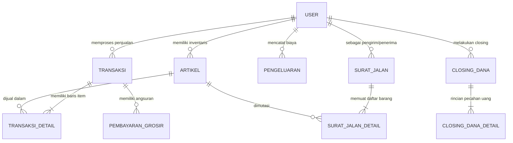
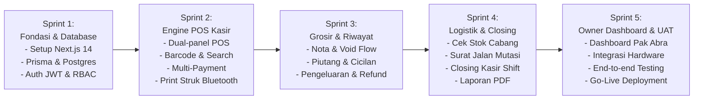

# 📄 PRODUCT REQUIREMENTS DOCUMENT (PRD) — FULL SCOPE
## MotaApp Web Platform — Ekosistem POS Kasir, Multi-Cabang & Manajemen Piutang Grosir
**Klien / Stakeholder:** Pak Abra (Client Mota Indonesia)  
**Disusun Oleh:** Xavortree Engineering & Product Team  
**Versi Dokumen:** 1.0.0 (Comprehensive Draft Edition)  
**Tanggal:** September 2026  
**Status:** Ready for Review & Feedback  
**Target Platform:** Web-Based Responsive (Optimasi Tablet Kasir, Desktop POS, dan Mobile Browser)  
**Target Pengguna:** Kasir Toko Retail, Operator Grosir, Tim Gudang Cabang, dan Pemilik/Super Admin (Pak Abra)  

---

## 1. Latar Belakang & Visi Produk

### 1.1 Latar Belakang
Aplikasi operasional kasir MotaApp sebelumnya berjalan pada platform Android native (React Native 0.76.2) dengan arsitektur backend warisan (*legacy PHP API*). Meskipun telah berhasil memfasilitasi transaksi harian, terdapat sejumlah tantangan operasional dan teknis:
1. **Ketergantungan Perangkat Keras HP/Tablet Android Tertentu:** Sulit dijalankan secara fleksibel di PC kasir, laptop toko, atau perangkat kasir serbaguna (*all-in-one POS*).
2. **Keamanan & Integritas Data:** Versi terdahulu mengandalkan autentikasi username polos di HTTP body tanpa enkripsi token sesi (JWT), serta kalkulasi diskon/subtotal di sisi klien (*client-side*) yang rentan manipulasi.
3. **Kebutuhan Multi-Outlet Terpusat:** Kebutuhan monitoring terpusat untuk Pak Abra dan manajemen dalam melihat pergerakan stok antar-cabang, piutang tempo grosir, dan rekonsiliasi kas harian secara *real-time*.

### 1.2 Visi & Tujuan Produk
Membangun platform **MotaApp Web Platform** modern berbasis **Next.js 14, Tailwind CSS, PostgreSQL, dan Prisma ORM** yang mengadopsi 100% logika bisnis eksisting, meningkatkan efisiensi kasir, menjamin keamanan transaksi enterprise-grade, dan mendukung integrasi hardware standar industri (USB Barcode Scanner, Webcam Scanner, dan Printer Thermal Bluetooth/USB ESC-POS).

---

## 2. Pengguna Sistem & Matriks Hak Akses (RBAC Matrix)

### 2.1 Persona Pengguna
1. **Kasir Toko (Role: `toko`):**
   - Menjalankan transaksi penjualan retail harian.
   - Mengelola uang kas kecil (*opening cash*), input pengeluaran operasional toko, dan melakukan *closing dana* shift.
   - Melakukan pengecekan stok di cabang lain dan mengajukan mutasi stok (*surat jalan*).
2. **Operator Grosir (Role: `grosir`):**
   - Menjalankan transaksi penjualan partai besar / grosir dengan harga grosir.
   - Mengelola penjualan sistem tempo / piutang (*keep & bayar jatuh tempo*).
   - Mencatat pembayaran cicilan / angsuran piutang konsumen beserta bukti transfer.
3. **Staf Gudang (Role: `gudang`):**
   - Mengelola stok master dan stok opname berkala.
   - Menerima, meninjau, dan menyetujui (*approve*) permohonan mutasi stok barang antar-cabang via Surat Jalan.
4. **Owner / Super Admin (Pak Abra & Tim Manajemen):**
   - Akses visibilitas total seluruh toko/cabang.
   - Monitoring omset harian, laba kotor, piutang macet, dan rekonsiliasi kas harian (*closing dana*).
   - Manajemen akun kasir, artikel produk, harga modal vs jual, serta konfigurasi toko.

### 2.2 Matriks Hak Akses Fitur (CRUD & Print/Download)

| Modul / Fitur | Kasir Toko (`toko`) | Operator Grosir (`grosir`) | Staf Gudang (`gudang`) | Owner / Admin (Pak Abra) |
| :--- | :---: | :---: | :---: | :---: |
| **Login & Profil Toko** | V, U | V, U | V, U | V, C, U, D |
| **Layar Kasir POS Retail** | V, C, P | V, C, P | - | V, P |
| **Transaksi Grosir & Piutang** | - | V, C, U, P | - | V, U, P |
| **Pembayaran Cicilan Piutang** | - | V, C, U, DL | - | V, C, U, DL |
| **Riwayat Transaksi & Void** | V, P (Hari ini) | V, P (Hari ini) | V (Histori) | V, U, D, P, DL |
| **Katalog & Stok Opname** | V | V | V, U, DL | V, C, U, D, DL |
| **Surat Jalan (Request)** | V, C | V, C | V, C | V, C, U |
| **Surat Jalan (Approval Mutasi)**| - | - | V, U (Approve) | V, U (Approve) |
| **Pengeluaran Operasional** | V, C | V, C | V, C | V, C, U, D, DL |
| **Refund Transaksi Konsumen** | V, C | V, C | - | V, C, U, D |
| **Closing Dana Shift Kasir** | V, C, P | V, C, P | V, C, P | V, P, DL (All Outlets) |
| **Master User & Hak Akses** | - | - | - | V, C, U, D |
| **Laporan Eksekutif & Omset** | - | - | - | V, DL (Excel/PDF) |

*Keterangan: V = View, C = Create, U = Update, D = Delete/Void, P = Print Struk ESC-POS, DL = Download PDF/CSV.*

---

## 3. Spesifikasi Ruang Lingkup Fitur (Functional Scope)

---

### MODUL 1: AUTENTIKASI, SESI & PROFIL TOKO (F1)
* **F1.1 Autentikasi Sesi Aman (JWT):** Kasir login menggunakan username/kode kasir dan password. Sistem menerbitkan JWT token yang disimpan aman di HttpOnly Cookies.
* **F1.2 Pemulihan Kata Sandi (2-Step Verification):** Mekanisme reset password berbasis kode verifikasi email / SMS tanpa kebocoran data sensitif.
* **F1.3 Profil Toko & Header Struk:** Pengaturan nama outlet, alamat cabang, nomor telepon operasional, serta unggah logo toko yang akan otomatis tercetak di header struk kasir.

---

### MODUL 2: MASTER PRODUK, PRICING & INVENTARIS (F2)
* **F2.1 Master Artikel:** Setiap produk memiliki atribut `artikel` (nama), `kode_artikel` (barcode unik), `kategori`, `harga_jual`, `harga_grosir`, `harga_modal` (terkunci hanya untuk admin), `size`, dan `satuan`.
* **F2.2 Stok Terpusat per Cabang:** Sistem memetakan kuantitas stok produk per masing-masing ID Toko/Cabang.
* **F2.3 Multi-Level Pricing:** Kasir dapat memilih mode harga Retail vs Grosir secara dinamis sesuai tipe konsumen yang dilayani.

---

### MODUL 3: ENGINE POS KASIR & MULTI-METODE PEMBAYARAN (F3)
* **F3.1 Input Item Super Cepat:**
  - Integrasi USB Barcode Scanner (deteksi keystroke instan tanpa perlu klik form).
  - Integrasi Webcam Scanner (menggunakan library HTML5-QRCode untuk tablet/laptop tanpa scanner tembak).
  - Pencarian manual dengan autocomplete responsif (< 50ms) berdasarkan nama atau kode barang.
* **F3.2 Manajemen Keranjang Belanja:**
  - Penambahan/pengurangan kuantitas instan.
  - Modifikasi harga jual per baris item (*custom price kasir*) dengan batasan toleransi minimum harga modal.
  - Diskon fleksibel: Diskon per item (nominal/persen) dan diskon global per nota.
* **F3.3 Multi-Metode Pembayaran:**
  - **Tunai (Cash):** Input nominal bayar dengan auto-kalkulasi uang kembalian (*change*). Tombol pintasan uang pas (Rp 20k, 50k, 100k, dsb).
  - **Non-Tunai (Transfer Bank / QRIS):** Pemilihan rekening bank toko tujuan, input referensi transaksi, dan opsi upload bukti transfer.
  - **Grosir / Tempo (Piutang):** Khusus konsumen terdaftar grosir. Input jatuh tempo pelunasan, status nota tercatat `belum` lunas.
* **F3.4 Pencetakan Struk Thermal Otomatis:**
  - Integrasi Web Bluetooth API langsung ke printer thermal kasir (58mm dan 80mm).
  - Kompatibel dengan protokol standar ESC/POS (cetak logo mono, garis pemisah, perataan teks, dan pemotong kertas otomatis/kick drawer).
  - Fallback ke browser system print (`@media print`) jika Bluetooth tidak aktif.

---

### MODUL 4: RIWAYAT NOTA, VOID & AUDIT TRAIL (F4)
* **F4.1 Monitoring Nota Penjualan:** Riwayat transaksi dengan filter rentang tanggal, kasir, status nota (*Lunas* / *Belum Lunas* / *Dibatalkan*), dan metode pembayaran.
* **F4.2 Cetak Ulang Nota:** Kemampuan mencetak ulang struk lama dengan tanda air (*watermark*) "COPY STRUK".
* **F4.3 Pembatalan Transaksi (Void Policy):**
  - Pembatalan transaksi wajib menyertakan alasan pembatalan tertulis.
  - Pembatalan nota otomatis mengembalikan stok barang ke database (*inventory rollback*).
  - Hak akses void dapat dikunci memerlukan PIN supervisor/admin.

---

### MODUL 5: MANAJEMEN PIUTANG & JATUH TEMPO GROSIR (F5)
* **F5.1 Buku Piutang Konsumen Grosir:** Daftar seluruh nota tempo yang belum lunas, diurutkan berdasarkan tanggal jatuh tempo terdekat (*aging schedule*).
* **F5.2 Pembayaran Angsuran Bertahap:**
  - Konsumen dapat mencicil pembayaran sebagian.
  - Setiap cicilan tercatat di tabel `PEMBAYARAN_GROSIR` dengan timestamp, nama kasir penerima, nominal bayar, dan sisa tagihan ter-update otomatis.
* **F5.3 Status Otomatis:** Jika akumulasi angsuran sama dengan total nota, status transaksi otomatis beralih menjadi `lunas`.

---

### MODUL 6: PENGELUARAN KAS TOKO & REFUND TRANSAKSI (F6)
* **F6.1 Pengeluaran Operasional Harian:** Pencatatan arus kas keluar toko dengan kategorisasi baku:
  1. *Operasional Toko*
  2. *Uang Makan Tim*
  3. *Listrik & Air*
  4. *Bensin & Transportasi*
  5. *Lain-lain*
* **F6.2 Refund Belanja Konsumen:**
  - Fasilitas pengembalian dana jika terjadi retur barang dari konsumen.
  - Mengurangi kas harian dan mengembalikan saldo fisik stok barang.

---

### MODUL 7: MUTASI STOK ANTAR-CABANG / SURAT JALAN (F7)
* **F7.1 Cek Stok Lintas Cabang:** Kasir toko A dapat melihat ketersediaan stok produk di Toko B, Toko C, atau Gudang Pusat secara transparan.
* **F7.2 Pengajuan Permohonan Mutasi:** Toko pemohon membuat draf *Surat Jalan* berisi daftar artikel dan kuantitas yang dibutuhkan.
* **F7.3 Approval Workflow Staf Gudang / Cabang Pengirim:**
  - Pihak pengirim memverifikasi ketersediaan fisik.
  - Saat tombol *Approve* ditekan, sistem secara otomatis melakukan mutasi stok atomik: memotong stok cabang pengirim dan menambah stok cabang penerima.
* **F7.4 Dokumen Surat Jalan Resmi:** Cetak surat jalan rangkap standar pengiriman barang dengan nomor dokumen unik (`SJ-YYYYMMDD-XXXX`).

---

### MODUL 8: CLOSING DANA SHIFT KASIR & REKONSILIASI KAS (F8)
* **F8.1 Rekonsiliasi Kas Shift Harian:**
  - Menghitung formula kas otomatis:
    $$\text{Total Kas Akhir Fisik} = \text{Kas Awal (Modal)} + \text{Omset Tunai} - \text{Pengeluaran Kas} - \text{Refund}$$
* **F8.2 Deteksi Selisih Kas (Over/Short):** Kasir menginput nominal uang fisik di laci kasir; sistem langsung menampilkan apakah kas sesuai, lebih (*over*), atau kurang (*short*).
* **F8.3 Kunci Sesi (Shift Lock):** Setelah disubmit, transaksi pada sesi shift tersebut dikunci (*read-only*) untuk mencegah manipulasi data susulan.
* **F8.4 Cetak Laporan Shift PDF & Thermal:** Ringkasan closing dapat langsung dicetak pada printer thermal 80mm atau diunduh sebagai berkas PDF resmi untuk arsip Pak Abra.

---

## 4. Arsitektur Teknis & Database

### 4.1 Tech Stack Web-Based Baru
* **Frontend:** Next.js 14 App Router, React 18, Tailwind CSS, Lucide Icons, Radix UI.
* **State Management:** Zustand (Cart state yang persisten dan cepat).
* **Backend API:** Next.js Server Actions & REST API Route Handlers (Node.js).
* **ORM & Database:** Prisma ORM dengan basis data PostgreSQL Relasional.
* **Hardware Interfacing:**
  - Barcode Scanner: Native DOM Keyboard Listener (mendeteksi input berkecepatan tinggi dengan suffix Enter).
  - Thermal Printer: Web Bluetooth API (GATT Service Characteristic) dengan format encoder ESC/POS.
  - Dokumen & Laporan: jsPDF + html2canvas / `@react-pdf/renderer`.

### 4.2 Skema Database Relasional (10 Entitas Inti)

---

## 5. Rencana Integrasi Hardware Kasir

1. **Printer Thermal Bluetooth (58mm & 80mm):**
   - Menggunakan protokol Web Bluetooth (`navigator.bluetooth.requestDevice`).
   - Standard Service UUID: `000018f0-0000-1000-8000-00805f9b34fb` (atau vendor default Bluetooth SPP).
   - Format cetak terstandardisasi ESC/POS: Header Logo, Nama Toko, Tanggal/Kasir, Item Belanja tabular, Subtotal/Diskon, Footer ucapan terima kasih.
2. **Barcode Scanner USB & Nirkabel:**
   - Berfungsi sebagai Virtual Keyboard Wedge tanpa perlu driver tambahan di sistem operasi komputer/laptop.
3. **Webcam / Mobile Camera Barcode Reader:**
   - Disediakan modul scanner kamera browser menggunakan library `html5-qrcode` untuk fleksibilitas perangkat tablet kasir.

---

## 6. Non-Functional Requirements (NFR)

* **Kecepatan & Responsivitas:** Halaman kasir merespons pencarian barang dalam waktu $< 100\text{ ms}$. Waktu proses checkout dari penekanan tombol bayar hingga perintah print struk $< 1\text{ detik}$.
* **Keamanan Data:** Autentikasi berbasis token JWT tersimpan di HttpOnly Cookie terlindung dari serangan XSS dan CSRF. Seluruh kalkulasi harga, potongan diskon, dan saldo divalidasi ulang di backend.
* **Integritas Transaksional (ACID):** Transaksi checkout dan mutasi stok surat jalan dijalankan di dalam blok transaksi PostgreSQL terisolasi (`prisma.$transaction`) untuk mencegah *race condition* atau stok ganda.
* **Ketersediaan & Audit:** Seluruh aktivitas transaksi, void nota, dan mutasi dana memiliki log audit lengkap (*who, what, when*).

---

## 7. Roadmap & Tahapan Pengerjaan (5 Sprint)

* **Sprint 1 (Minggu 1-2):** Setup repositori Next.js 14, database schema PostgreSQL, migrasi Prisma ORM, arsitektur keamanan JWT, dan modul manajemen akun/profil toko.
* **Sprint 2 (Minggu 3-4):** Antarmuka utama Layar Kasir POS (dual-panel desktop/tablet), integrasi Barcode Scanner, keranjang belanja dinamis, kalkulasi diskon, multi-payment, dan integrasi driver cetak struk ESC/POS Web Bluetooth.
* **Sprint 3 (Minggu 5-6):** Modul riwayat nota, mekanisme audit void transaksi, modul penjualan tempo grosir, pencatatan angsuran cicilan piutang, serta modul pencatatan pengeluaran harian dan refund.
* **Sprint 4 (Minggu 7-8):** Modul stock opname, alur permohonan dan approval Surat Jalan mutasi stok antar-cabang, serta sistem kalkulasi Closing Dana kasir harian beserta export PDF.
* **Sprint 5 (Minggu 9-10):** Dashboard analitik eksekutif untuk Pak Abra (grafik omset harian/bulanan, stok menipis, monitoring piutang), pengujian hardware di lapangan, UAT (*User Acceptance Testing*), dan deployment ke server produksi.

---

## 8. Pertanyaan Terbuka & Rekomendasi untuk Diskusi Bersama Pak Abra

1. **Format Identitas Pelanggan Grosir:** Apakah data pelanggan grosir (nama, nomor WhatsApp, alamat toko) perlu dibuatkan modul *Master Customer Grosir* tersendiri di web, atau cukup diinput manual saat transaksi kasir seperti versi Android lama? *(Rekomendasi: Tambahkan Master Customer agar riwayat piutang per pelanggan lebih rapi)*.
2. **Otorisasi Pembatalan Nota (Void):** Apakah kasir boleh membatalkan nota secara mandiri dengan mencatat alasan, atau wajib memasukkan PIN/otorisasi dari Supervisor/Pak Abra?
3. **Penyimpanan Gambar Struk & Logo:** Apakah ingin menggunakan local storage server atau integrasi cloud storage (seperti AWS S3 / Cloudflare R2 / Supabase Storage) untuk bukti bayar transfer dan logo toko?
4. **Target Hardware Utama di Toko:** Apakah mayoritas kasir nantinya akan menggunakan Laptop/PC Windows dengan printer USB thermal, atau menggunakan Tablet Android/iPad dengan printer Bluetooth? *(Sistem web yang kami rancang mendukung keduanya)*.
