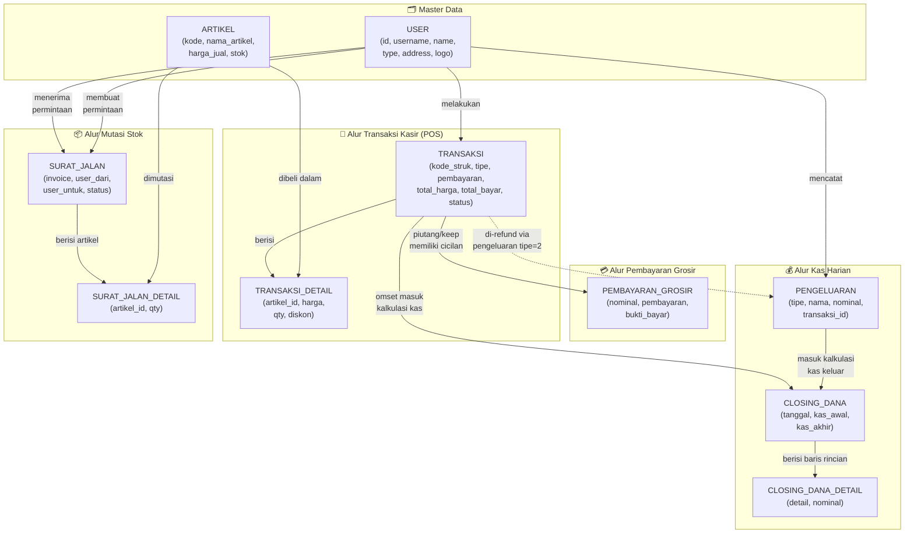

# Database Schema — MotaApp Indonesia
### Hasil Scraping Data Aplikasi Android → Referensi Planning Web-Based

> Semua tabel, kolom, tipe data, dan relasi di bawah ini diidentifikasi secara menyeluruh dari **source code Android** (API request/response, state management, form fields, dan render logic). Bukan rekaan — semuanya berbasis data aktual dari kode.

---

## 1. ERD Lengkap — Semua Entitas & Relasi

```mermaid
erDiagram

    %% =====================
    %% USER & PROFIL TOKO
    %% =====================
    USER {
        int        id           PK
        varchar    username     UK   "dipakai sebagai auth di setiap API request"
        varchar    password
        varchar    name              "nama toko / outlet"
        varchar    alias             "nama singkat toko"
        varchar    email
        enum       type              "toko | grosir | gudang"
        varchar    hp                "nomor telepon"
        text       address
        varchar    image             "filename logo di folder assets/user_logo/"
        longtext   image_base64      "base64 logo untuk cetak struk thermal"
        timestamp  created_at
        timestamp  updated_at
    }

    %% =====================
    %% PRODUK / ARTIKEL
    %% =====================
    ARTIKEL {
        int        id           PK
        varchar    kode         UK   "barcode / kode produk"
        varchar    nama_artikel
        decimal    harga_jual
        int        stok
        varchar    image             "filename di assets/artikel_image/"
        int        user_id      FK
        timestamp  created_at
        timestamp  updated_at
    }

    %% =====================
    %% TRANSAKSI (HEADER)
    %% =====================
    TRANSAKSI {
        int        id           PK
        varchar    kode_struk   UK   "no. struk e.g. TRX/2024/001"
        int        user_id      FK
        timestamp  tanggal
        tinyint    tipe              "1=retail | 2=grosir"
        tinyint    pembayaran        "1=cash | 2=transfer"
        tinyint    pembayaran_grosir "0=normal | 3=piutang | 4=keep"
        decimal    total_harga       "subtotal - total_diskon"
        decimal    total_bayar       "nominal yg dibayarkan (bisa < total_harga jika DP)"
        decimal    total_diskon      "Σ(diskon_item) + diskon_tambahan"
        tinyint    status            "1=belum_lunas | 2=lunas | 3=dibatalkan"
        date       jatuh_tempo       "nullable - khusus tipe piutang"
        json       data_transfer     "{ bank, no_rekening, atas_nama } - jika transfer"
        varchar    bukti_bayar       "filename bukti transfer di assets/bukti_bayar/"
        text       keterangan
        timestamp  created_at
    }

    %% =====================
    %% TRANSAKSI DETAIL (ITEM)
    %% =====================
    TRANSAKSI_DETAIL {
        int        id           PK
        int        transaksi_id FK
        int        artikel_id   FK
        varchar    kode_artikel      "snapshot kode saat transaksi"
        varchar    nama_artikel      "snapshot nama saat transaksi"
        decimal    harga             "harga aktual saat jual (bisa diubah kasir)"
        int        qty
        decimal    diskon            "diskon per item"
        text       keterangan
    }

    %% =====================
    %% LOG CICILAN / DP GROSIR
    %% =====================
    PEMBAYARAN_GROSIR {
        int        id           PK
        int        transaksi_id FK
        timestamp  tanggal
        decimal    nominal            "jumlah bayar saat ini"
        tinyint    pembayaran         "1=cash | 2=transfer"
        varchar    bukti_bayar        "filename bukti transfer"
        json       data_transfer      "{ bank, no_rekening, atas_nama }"
    }

    %% =====================
    %% PENGELUARAN & REFUND
    %% =====================
    PENGELUARAN {
        int        id              PK
        int        user_id         FK
        varchar    nama                "label pengeluaran"
        tinyint    tipe                "1=harian | 2=refund | 3=lainnya | 4=transfer | 5=setoran"
        decimal    nominal
        int        transaksi_id    FK  "nullable - diisi jika tipe=refund(2)"
        text       keterangan
        timestamp  tanggal
    }

    %% =====================
    %% SURAT JALAN (HEADER)
    %% =====================
    SURAT_JALAN {
        int        id              PK
        varchar    invoice         UK  "no. surat jalan"
        int        user_dari_id    FK  "toko yang meminta stok"
        int        user_untuk_id   FK  "toko yang memiliki stok"
        varchar    address_dari        "snapshot alamat toko peminta"
        varchar    address_untuk       "snapshot alamat toko pemilik"
        tinyint    status              "1=menunggu | 2=ditolak | 3=diterima"
        timestamp  tanggal
    }

    %% =====================
    %% SURAT JALAN DETAIL
    %% =====================
    SURAT_JALAN_DETAIL {
        int        id              PK
        int        surat_jalan_id  FK
        int        artikel_id      FK
        varchar    nama_artikel        "snapshot nama artikel"
        int        qty                 "jumlah yang diminta"
    }

    %% =====================
    %% CLOSING DANA (HEADER)
    %% =====================
    CLOSING_DANA {
        int        id          PK
        int        user_id     FK
        date       tanggal     UK  "UNIQUE per user per hari — cegah double closing"
        decimal    kas_awal
        decimal    kas_akhir
        timestamp  created_at
    }

    %% =====================
    %% CLOSING DANA DETAIL (LINE ITEMS)
    %% =====================
    CLOSING_DANA_DETAIL {
        int        id              PK
        int        closing_dana_id FK
        varchar    detail              "label item (Omset Retail, Omset Keep, Nama Pengeluaran, dll)"
        decimal    nominal             "positif = pemasukan, negatif = pengeluaran"
    }

    %% =====================
    %% RELASI
    %% =====================
    USER              ||--o{ ARTIKEL             : "memiliki produk"
    USER              ||--o{ TRANSAKSI           : "melakukan transaksi"
    TRANSAKSI         ||--|{ TRANSAKSI_DETAIL    : "memiliki item"
    ARTIKEL           ||--o{ TRANSAKSI_DETAIL    : "dijual dalam transaksi"
    TRANSAKSI         ||--o{ PEMBAYARAN_GROSIR   : "memiliki log cicilan"
    USER              ||--o{ PENGELUARAN         : "mencatat pengeluaran"
    TRANSAKSI         ||--o{ PENGELUARAN         : "di-refund via pengeluaran"
    USER              ||--o{ SURAT_JALAN         : "membuat (dari)"
    USER              ||--o{ SURAT_JALAN         : "menerima (untuk)"
    SURAT_JALAN       ||--|{ SURAT_JALAN_DETAIL  : "berisi artikel"
    ARTIKEL           ||--o{ SURAT_JALAN_DETAIL  : "dimutasi"
    USER              ||--o{ CLOSING_DANA        : "menutup kas harian"
    CLOSING_DANA      ||--|{ CLOSING_DANA_DETAIL : "berisi rincian baris"
```



---

## 2. Alur Data Antar Schema (Flow Diagram)

Diagram ini menunjukkan **bagaimana data mengalir** antar tabel dalam setiap skenario bisnis.



---

## 3. Schema Per Modul + Kolom Penting

### 3.1 Modul Autentikasi — Tabel `USER`

| Kolom | Tipe | Constraint | Sumber Data |
|:---|:---|:---|:---|
| `id` | INT | PK, AUTO_INCREMENT | — |
| `username` | VARCHAR(100) | UNIQUE, NOT NULL | `auth/login` request + session storage |
| `password` | VARCHAR(255) | NOT NULL | `auth/login` request |
| `name` | VARCHAR(255) | NOT NULL | `data_user.name` — ditampilkan di profil & header struk |
| `alias` | VARCHAR(100) | NULLABLE | `data_user.alias` — nama singkat toko |
| `email` | VARCHAR(255) | | `auth/check_user` untuk reset password |
| `type` | ENUM | NOT NULL | `data_user.type` — mengontrol menu drawer |
| `hp` | VARCHAR(20) | | Ditampilkan di struk thermal |
| `address` | TEXT | | Ditampilkan di struk thermal |
| `image` | VARCHAR(255) | NULLABLE | Filename di `/assets/user_logo/` |
| `image_base64` | LONGTEXT | NULLABLE | Disimpan di session untuk cetak struk offline |

---

### 3.2 Modul Produk — Tabel `ARTIKEL`

| Kolom | Tipe | Constraint | Sumber Data |
|:---|:---|:---|:---|
| `id` | INT | PK | `stockopname/list` response |
| `kode` | VARCHAR(50) | UNIQUE | Scan barcode → dicari via kode ini |
| `nama_artikel` | VARCHAR(255) | NOT NULL | Ditampilkan di katalog + struk |
| `harga_jual` | DECIMAL(12,2) | NOT NULL | Default harga (bisa di-override kasir) |
| `stok` | INT | NOT NULL | Dikurangi otomatis saat `transaksi/save_trx` |
| `image` | VARCHAR(255) | NULLABLE | Ditampilkan di katalog produk |
| `user_id` | INT | FK → USER | Produk milik toko tertentu |

---

### 3.3 Modul Transaksi — Tabel `TRANSAKSI` + `TRANSAKSI_DETAIL`

#### `TRANSAKSI` (Header)

| Kolom | Tipe | Constraint | Sumber Data |
|:---|:---|:---|:---|
| `id` | INT | PK | |
| `kode_struk` | VARCHAR(50) | UNIQUE | Generate by server (e.g. `TRX/2024/08/001`) |
| `user_id` | INT | FK → USER | `user: data_user.username` |
| `tanggal` | TIMESTAMP | NOT NULL | Server timestamp |
| `tipe` | TINYINT | NOT NULL | `1`=Retail, `2`=Grosir |
| `pembayaran` | TINYINT | NOT NULL | `1`=Cash, `2`=Transfer |
| `pembayaran_grosir` | TINYINT | NOT NULL | `0`=Normal, `3`=Piutang, `4`=Keep |
| `total_harga` | DECIMAL(12,2) | NOT NULL | `Σ(harga × qty) - Σ(diskon_item) - diskon_tambahan` |
| `total_bayar` | DECIMAL(12,2) | NOT NULL | Nominal uang diterima / DP yang dibayar |
| `total_diskon` | DECIMAL(12,2) | DEFAULT 0 | Gabungan semua diskon |
| `status` | TINYINT | NOT NULL | `1`=Belum Lunas, `2`=Lunas, `3`=Dibatalkan |
| `jatuh_tempo` | DATE | NULLABLE | Hanya jika `pembayaran_grosir = 3` (Piutang) |
| `data_transfer` | JSON | NULLABLE | `{ bank, no_rekening, atas_nama }` |
| `bukti_bayar` | VARCHAR(255) | NULLABLE | Filename di `/assets/bukti_bayar/` |

#### `TRANSAKSI_DETAIL` (Item Lines)

| Kolom | Tipe | Constraint | Sumber Data |
|:---|:---|:---|:---|
| `id` | INT | PK | |
| `transaksi_id` | INT | FK → TRANSAKSI | |
| `artikel_id` | INT | FK → ARTIKEL | |
| `kode_artikel` | VARCHAR(50) | | Snapshot — tidak berubah jika produk dihapus |
| `nama_artikel` | VARCHAR(255) | | Snapshot |
| `harga` | DECIMAL(12,2) | | Harga aktual saat jual (**bisa berbeda** dari `harga_jual` default) |
| `qty` | INT | | |
| `diskon` | DECIMAL(12,2) | DEFAULT 0 | Diskon per item |
| `keterangan` | TEXT | NULLABLE | Catatan per item |

> ⚠️ **Penting:** Kolom `harga` di `TRANSAKSI_DETAIL` bisa berbeda dari `ARTIKEL.harga_jual` karena kasir bisa **mengubah harga jual secara manual** per transaksi (`edited_harga` di kode Android).

---

### 3.4 Modul Piutang/Keep — Tabel `PEMBAYARAN_GROSIR`

| Kolom | Tipe | Constraint | Sumber Data |
|:---|:---|:---|:---|
| `id` | INT | PK | |
| `transaksi_id` | INT | FK → TRANSAKSI | |
| `tanggal` | TIMESTAMP | NOT NULL | |
| `nominal` | DECIMAL(12,2) | NOT NULL | Jumlah cicilan/bayar kali ini |
| `pembayaran` | TINYINT | NOT NULL | `1`=Cash, `2`=Transfer |
| `bukti_bayar` | VARCHAR(255) | NULLABLE | |
| `data_transfer` | JSON | NULLABLE | |

> **Catatan Bisnis:** Sisa tagihan dihitung client-side: `sisa = TRANSAKSI.total_harga - Σ(PEMBAYARAN_GROSIR.nominal)`. Jika sisa = 0, status TRANSAKSI diupdate ke `2` (Lunas).

---

### 3.5 Modul Pengeluaran — Tabel `PENGELUARAN`

| Kolom | Tipe | Constraint | Sumber Data |
|:---|:---|:---|:---|
| `id` | INT | PK | |
| `user_id` | INT | FK → USER | |
| `nama` | VARCHAR(255) | NOT NULL | Label pengeluaran (e.g. "Beli Plastik", "Refund TRX/2024/001") |
| `tipe` | TINYINT | NOT NULL | `1`=Harian, `2`=Refund Transaksi, `3`=Lainnya, `4`=Transfer, `5`=Setoran |
| `nominal` | DECIMAL(12,2) | NOT NULL | |
| `transaksi_id` | INT | FK → TRANSAKSI | NULLABLE — diisi hanya jika `tipe = 2` (Refund) |
| `keterangan` | TEXT | NULLABLE | |
| `tanggal` | TIMESTAMP | NOT NULL | |

---

### 3.6 Modul Stok Antar Cabang — Tabel `SURAT_JALAN` + `SURAT_JALAN_DETAIL`

#### `SURAT_JALAN` (Header)

| Kolom | Tipe | Constraint | Sumber Data |
|:---|:---|:---|:---|
| `id` | INT | PK | |
| `invoice` | VARCHAR(50) | UNIQUE | No. surat jalan generate by server |
| `user_dari_id` | INT | FK → USER | `username` toko yang meminta stok |
| `user_untuk_id` | INT | FK → USER | `toko` target (username toko pemilik stok) |
| `address_dari` | VARCHAR(255) | | Snapshot alamat toko peminta (field: `item.address_untuk` di UI — perhatikan swap!) |
| `address_untuk` | VARCHAR(255) | | Snapshot alamat toko pemilik (field: `item.address_dari` di UI) |
| `status` | TINYINT | NOT NULL | `1`=Menunggu, `2`=Ditolak, `3`=Diterima |
| `tanggal` | TIMESTAMP | NOT NULL | |

> ⚠️ **Catatan Penting:** Di kode Android (`SuratJalanScreen.jsx` line 352-354), terdapat **swap label** `address_dari` dan `address_untuk` di UI. Perlu diklarifikasi dengan backend apakah ini bug tampilan atau naming convention berbeda.

#### `SURAT_JALAN_DETAIL` (Items)

| Kolom | Tipe | Constraint | Sumber Data |
|:---|:---|:---|:---|
| `id` | INT | PK | |
| `surat_jalan_id` | INT | FK → SURAT_JALAN | |
| `artikel_id` | INT | FK → ARTIKEL | |
| `nama_artikel` | VARCHAR(255) | | Snapshot nama |
| `qty` | INT | NOT NULL | Jumlah yang diminta/dimutasi |

---

### 3.7 Modul Closing Dana — Tabel `CLOSING_DANA` + `CLOSING_DANA_DETAIL`

#### `CLOSING_DANA` (Header)

| Kolom | Tipe | Constraint | Sumber Data |
|:---|:---|:---|:---|
| `id` | INT | PK | |
| `user_id` | INT | FK → USER | |
| `tanggal` | DATE | UNIQUE per user | Satu closing per hari per kasir |
| `kas_awal` | DECIMAL(12,2) | NOT NULL | Nilai awal dari `closingdana/detail` |
| `kas_akhir` | DECIMAL(12,2) | NOT NULL | `kas_awal + total_omset - total_pengeluaran` |
| `created_at` | TIMESTAMP | NOT NULL | |

#### `CLOSING_DANA_DETAIL` (Line Items Laporan)

| Kolom | Tipe | Constraint | Sumber Data |
|:---|:---|:---|:---|
| `id` | INT | PK | |
| `closing_dana_id` | INT | FK → CLOSING_DANA | |
| `detail` | VARCHAR(255) | | Label baris (e.g. "Omset Retail", "Pengeluaran: Beli Galon") |
| `nominal` | DECIMAL(12,2) | NOT NULL | Nilai positif = pemasukan, negatif = pengeluaran |

#### Kalkulasi Kas Akhir (Business Logic)

```
kas_akhir = kas_awal
          + omset_jatuh_tempo    (dari transaksi piutang yg dibayar hari ini)
          + omset_keep           (dari transaksi keep yg dibayar hari ini)  
          + total_omset          (total semua transaksi hari ini)
          - Σ(pengeluaran.nominal)  (semua pengeluaran hari ini)
```

---

## 4. Mapping Status & Enum Values

### Status Transaksi

| Value | Label | Kondisi |
|:---:|:---|:---|
| `1` | Belum Lunas | Transaksi baru / DP piutang / keep belum dilunasi |
| `2` | Lunas | Pembayaran cash/transfer tunai / piutang sudah dilunasi penuh |
| `3` | Dibatalkan | Void oleh kasir via `transaksi/batalkan` |

### Tipe Pembayaran (`pembayaran`)

| Value | Label | Field Tambahan |
|:---:|:---|:---|
| `1` | Cash | `total_bayar` (nominal tunai) |
| `2` | Transfer | `data_transfer` (JSON bank info) + `bukti_bayar` (file) |

### Tipe Pembayaran Grosir (`pembayaran_grosir`)

| Value | Label | Kondisi Status |
|:---:|:---|:---|
| `0` | Normal (Retail) | Status langsung Lunas jika cash/transfer |
| `3` | Piutang / Jatuh Tempo | Status = Belum Lunas, ada `jatuh_tempo` date |
| `4` | Keep | Status = Belum Lunas, bayar bisa nanti |

### Tipe Pengeluaran

| Value | Label | Masuk ke Closing Dana? |
|:---:|:---|:---:|
| `1` | Harian | ✅ Ya |
| `2` | Refund Transaksi | ✅ Ya |
| `3` | Lainnya | ✅ Ya |
| `4` | Transfer | ✅ Ya |
| `5` | Setoran | ✅ Ya |

### Status Surat Jalan

| Value | Label | Aksi |
|:---:|:---|:---|
| `1` | Menunggu | Tombol "Terima" & "Tolak" aktif di toko tujuan |
| `2` | Ditolak | Final — stok tidak berpindah |
| `3` | Diterima | Final — stok berpindah dari `user_untuk` ke `user_dari` |

---

## 5. Catatan Teknis untuk Planning Web-Based

> Bagian ini adalah **temuan penting** dari hasil scraping yang perlu diperhatikan saat membangun backend baru.

### ✅ Yang Berjalan Baik (Adopt langsung)
- Struktur API request/response yang konsisten (selalu ada `http_code`, `message`, `data`).
- Pagination via `limit` + `offset` — simple dan efektif.
- Snapshot data di `TRANSAKSI_DETAIL` (simpan `kode_artikel`, `nama_artikel`, `harga` saat transaksi) — **WAJIB dipertahankan** agar history tidak berubah jika produk diedit.

### ⚠️ Yang Perlu Diperbaiki di Web-Based
1. **Autentikasi:** Android memakai `username` di request body (bukan Bearer Token). Di web-based, **wajib gunakan JWT/Session token di header** (`Authorization: Bearer <token>`) untuk keamanan.
2. **Address Swap di Surat Jalan:** Field `address_dari` dan `address_untuk` tertukar labelnya di UI Android (kemungkinan bug). Perlu dikonfirmasi sebelum implementasi web.
3. **Kalkulasi Client-Side:** Semua kalkulasi (subtotal, diskon, sisa piutang) dilakukan di client Android. Di web-based, **validasi ulang di server** untuk mencegah manipulasi data.
4. **`image_base64` di session:** Android menyimpan base64 logo toko di `AsyncStorage` untuk cetak struk offline. Di web, gunakan **URL CDN** dan lazy-load base64 hanya saat diperlukan untuk print.
5. **Pagination masih manual** (prev/next button + offset). Di web, pertimbangkan **cursor-based pagination** untuk performa lebih baik dengan dataset besar.
