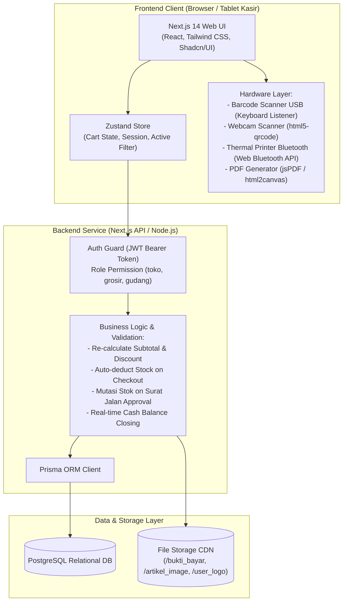
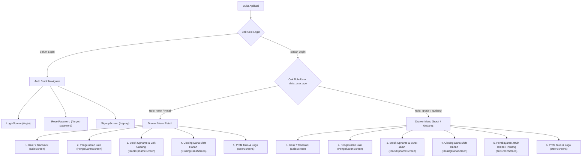
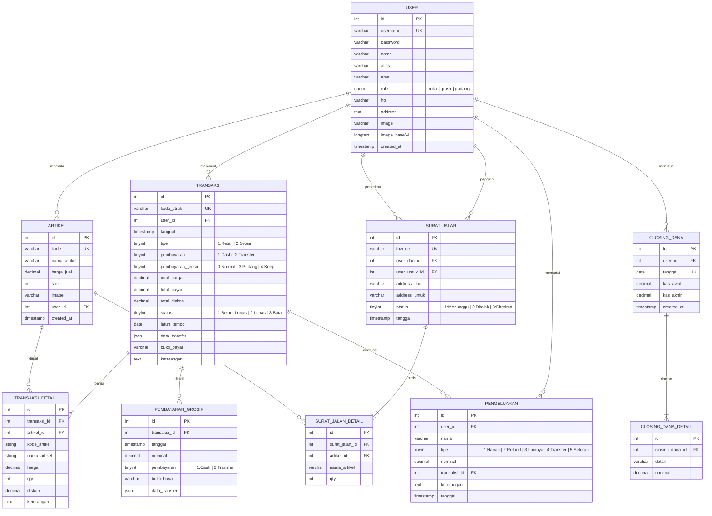
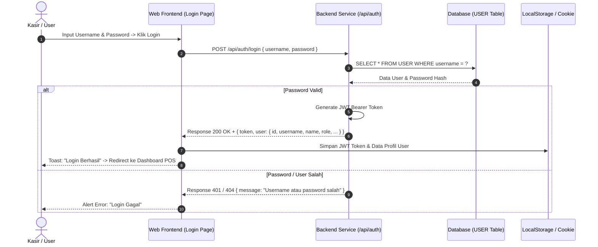
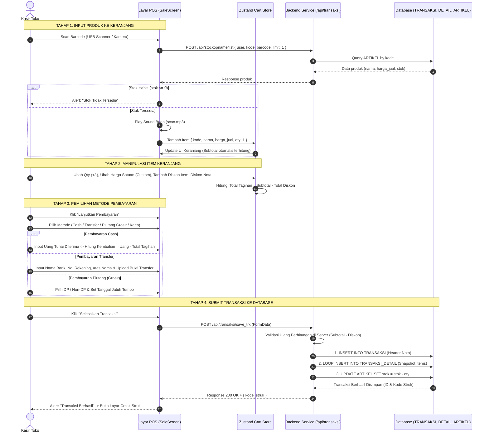
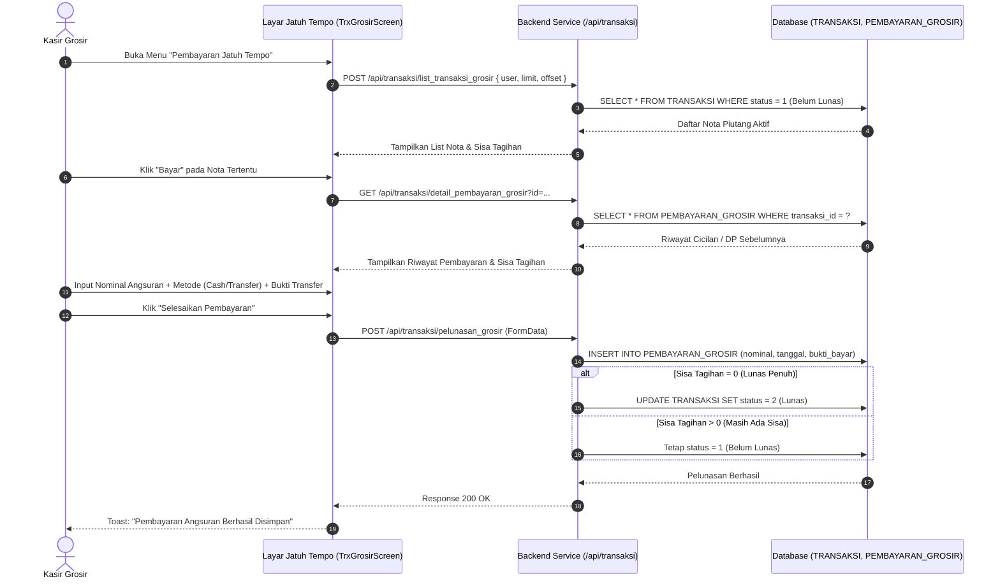
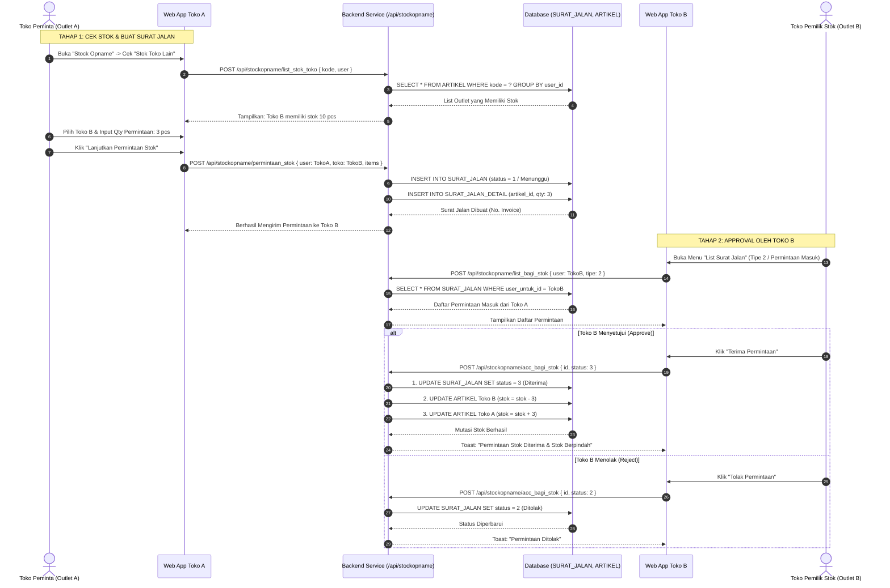
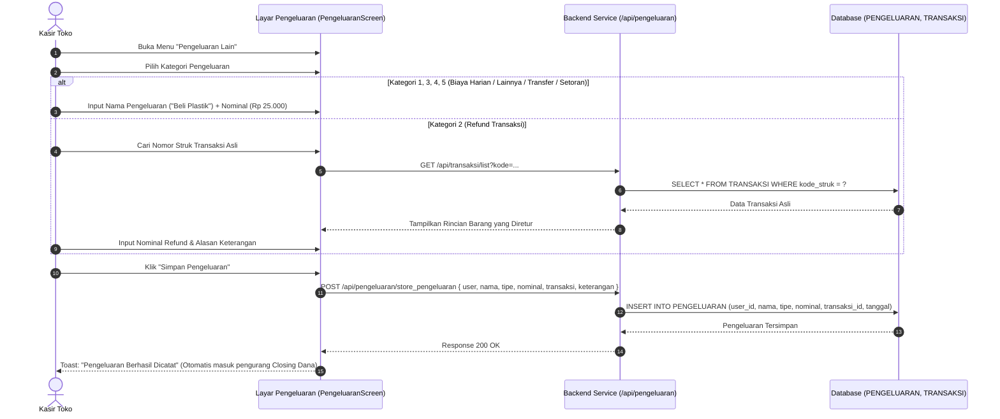
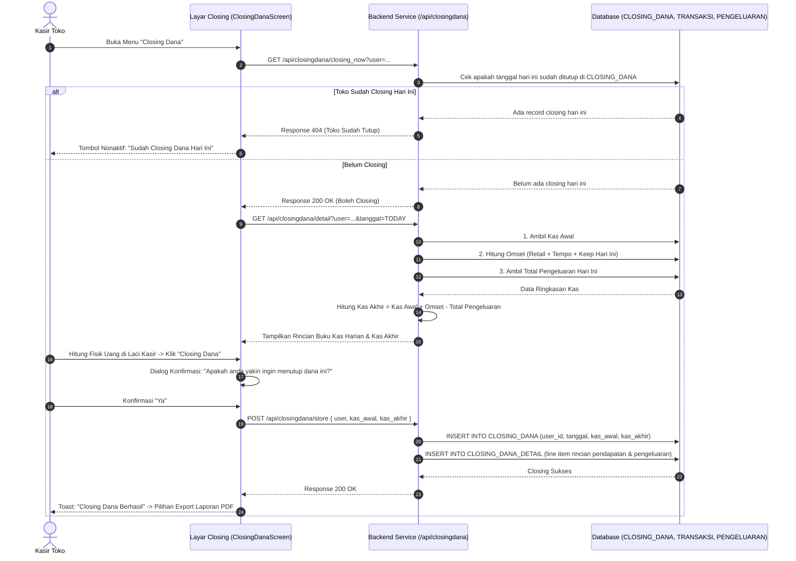
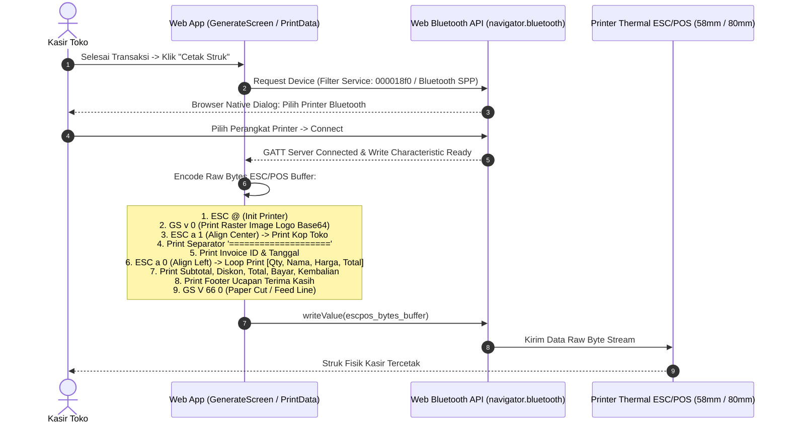

# Implementation Plan: Scraping Data & Cetak Biru Web-Based MotaApp
## Lengkap dengan Seluruh Diagram Mermaid (Arsitektur, ERD, dan 7 Sequence Diagram)

> Dokumen ini memuat **seluruh hasil scraping data aplikasi Android MotaApp** dan rencana pengembangannya ke platform **Web-Based**, dilengkapi dengan **10 Diagram Mermaid lengkap** (Arsitektur, ERD, Flowchart, dan Sequence Diagram untuk setiap alur bisnis).

---

## User Review Required

> [!IMPORTANT]
> **Daftar Seluruh Diagram Mermaid di Dokumen Ini:**
> 1. **Diagram 1:** Arsitektur Sistem & Hardware Android vs Web-Based
> 2. **Diagram 2:** Navigation Map & Role-Based Access Control
> 3. **Diagram 3:** Database Schema ERD (10 Tabel Relasional Lengkap)
> 4. **Diagram 4 (Sequence):** Alur Login & Session Management
> 5. **Diagram 5 (Sequence):** Alur Transaksi Kasir POS (Scan, Keranjang, Multi-Payment, Database)
> 6. **Diagram 6 (Sequence):** Alur Pembayaran Piutang & Cicilan Jatuh Tempo Grosir
> 7. **Diagram 7 (Sequence):** Alur Mutasi Stok Antar-Cabang (Surat Jalan & Approval)
> 8. **Diagram 8 (Sequence):** Alur Pengeluaran Kas & Refund Transaksi
> 9. **Diagram 9 (Sequence):** Alur Closing Dana Shift Kasir Harian
> 10. **Diagram 10 (Sequence):** Alur Cetak Struk Thermal Bluetooth ESC/POS

---

# SECTION 1: ARSITEKTUR & DIAGRAM MERMAID LENGKAP

---

### Diagram 1: Arsitektur Sistem & Integrasi Hardware

---

### Diagram 2: Navigation Map & Role-Based Access

---

### Diagram 3: Database Schema ERD (10 Tabel Relasional)

---

### Diagram 4: Sequence Diagram — Alur Login & Autentikasi

---

### Diagram 5: Sequence Diagram — Alur Transaksi Kasir POS (Scan, Keranjang, Multi-Payment)

---

### Diagram 6: Sequence Diagram — Alur Pelunasan Piutang & Jatuh Tempo Grosir

---

### Diagram 7: Sequence Diagram — Alur Mutasi Stok Antar-Cabang (Surat Jalan & Approval)

---

### Diagram 8: Sequence Diagram — Alur Pengeluaran Kas & Refund Transaksi

---

### Diagram 9: Sequence Diagram — Alur Closing Dana Shift Kasir Harian

---

### Diagram 10: Sequence Diagram — Alur Cetak Struk Thermal Bluetooth ESC/POS

---

# SECTION 2: MAPPING ADOPSI TEKNIS (ANDROID $\rightarrow$ WEB-BASED)

| Fitur / Komponen | Android Existing | Solusi Web-Based Baru |
| :--- | :--- | :--- |
| **Framework** | React Native 0.76.2 | Next.js 14 App Router (React 18, TypeScript) |
| **Styling & UI** | StyleSheet native | Tailwind CSS + Shadcn UI (Responsive Dual-Panel POS) |
| **Autentikasi** | Parameter plain `user: username` di body/params | Header `Authorization: Bearer <JWT>` + Secure Cookies |
| **Validasi Kalkulasi**| 100% dihitung di aplikasi HP | Di-recalculate dan divalidasi ketat di backend server |
| **Barcode Scanner** | Kamera HP (`react-native-camera-kit`) | Scanner Fisik USB (`onKeyDown` Enter listener) & Webcam (`html5-qrcode`) |
| **Thermal Printing**| Native SPP (`react-native-bluetooth-escpos-printer`)| Web Bluetooth API & CSS `@media print` 58mm/80mm |
| **Export PDF** | Local library `react-native-html-to-pdf` | Client-side export via `jspdf` & `html2canvas` |
| **Database** | Database lama (PHP backend) | **PostgreSQL** dengan **Prisma ORM** (10 tabel terstruktur) |
| **Dashboard** | Belum ada | **Dashboard Analytics Baru:** Grafik tren omset, top 10 produk, notifikasi stok |

---

# SECTION 3: ROADMAP IMPLEMENTASI (5 SPRINT)

* **Sprint 1 (Minggu 1):** Setup Project Next.js 14, Database PostgreSQL, Prisma ORM Schema, Autentikasi JWT & Role Guard.
* **Sprint 2 (Minggu 2):** Layar Kasir POS Dual-Panel, Barcode Scanner USB, Keranjang, Multi-Payment, Cetak Struk Bluetooth.
* **Sprint 3 (Minggu 3):** Riwayat Transaksi, Pelunasan Angsuran Piutang Grosir (Jatuh Tempo/Keep), Pengeluaran & Refund.
* **Sprint 4 (Minggu 4):** Stock Opname, Cek Stok Cabang, Surat Jalan Antar-Toko (Approve/Reject), Closing Kasir & PDF.
* **Sprint 5 (Minggu 5):** Dashboard Analytics & KPI Toko, Pengujian Hardware End-to-End, UAT & Deployment Staging.
