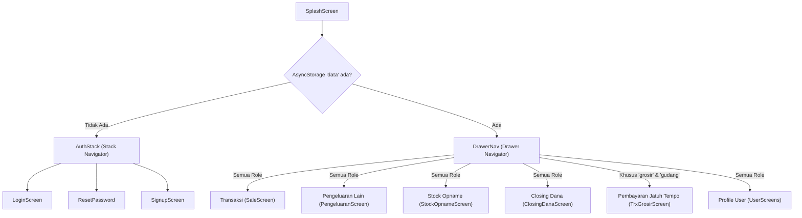
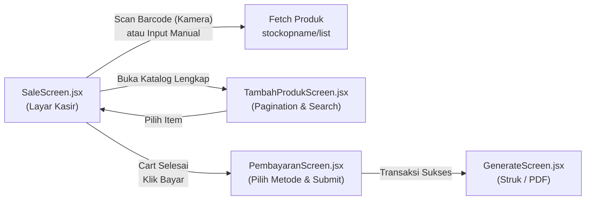

# Master Document: Hasil Scraping & Ekstraksi Menyeluruh Android MotaApp
### Dokumentasi Teknis Lengkap Seluruh Alur, Screen, Komponen, API, dan Logika Bisnis

Dokumen ini berisi hasil **reverse-engineering & ekstraksi data menyeluruh** dari seluruh codebase aplikasi Android **MotaApp (React Native 0.76.2)**. Dokumen ini dirancang sebagai **referensi utama (single source of truth)** bagi tim developer untuk memahami setiap detil alur kerja (*flow*), parameter data, kalkulasi, dan perilaku sistem.

---

## 1. Konfigurasi Lingkungan & Endpoint Global

### 1.1 Base URL & Path Asset (`src/providers/Client.js`)
* **Endpoint API Production:** `https://mota-indonesia.com/api/`
* **Endpoint API Dev/Fallback:** `http://202.157.185.124/mota-indonesia/api/` *(Catatan: ada komentar `10.0.2.2:80` untuk emulator Android)*
* **Asset CDN Bukti Bayar:** `https://mota-indonesia.com/assets/bukti_bayar/`
* **Asset CDN Gambar Produk:** `https://mota-indonesia.com/assets/artikel_image/`
* **Asset CDN Logo Toko:** `https://mota-indonesia.com/assets/user_logo/`

### 1.2 Format Request & Response Standar
* **HTTP Method:** `GET`, `POST`.
* **Standard Response Body:**
```json
{
  "http_code": 200,
  "message": "Pesan status dari server",
  "data": { ... } // atau array [ ... ]
}
```
* **Mekanisme Autentikasi:** Tidak memakai JWT Token di HTTP Header. Seluruh request menyertakan parameter `user: data_user.username` (string username akun kasir) baik via GET query parameter, POST JSON body, maupun POST FormData.
* **Persistent Local Storage:** Menggunakan `@react-native-async-storage/async-storage` dengan key utama `'data'` yang menyimpan objek JSON user.

---

## 2. Peta Navigasi & Role-Based Routing

### 2.1 Struktur Routing (`src/core/AuthStack.jsx` & `DrawerNav.jsx`)


### 2.2 Hak Akses Berdasarkan Role (`data_user.type`)
1. **`toko` / Retail:**
   - Akses: POS Kasir Retail, Pengeluaran & Refund, Stock Opname & Cek Stok Toko Lain, Closing Dana Harian, Profil Toko.
   - Menu Pembayaran Jatuh Tempo **disembunyikan** dari drawer navigasi.
2. **`grosir`:**
   - Akses: Seluruh menu Retail + Transaksi Tipe Grosir (Piutang & Keep) + Menu **Pembayaran Jatuh Tempo** (Pelunasan Angsuran / Cicilan).
3. **`gudang`:**
   - Akses: Sama dengan role Grosir + Fokus pada distribusi mutasi stok via Surat Jalan.

---

## 3. Ekstraksi Detail Modul-per-Modul

---

### MODUL 1: AUTENTIKASI & PROFIL TOKO

#### 1. Login Screen (`src/screens/auth/LoginScreen.jsx`)
* **State Lokal:** `username`, `password`, `loader` (boolean).
* **API Call:** `POST /api/auth/login`
  - **Payload:** `{ username: string, password: string }`
  - **Success (200):** Menyimpan response `response.data.data` ke `AsyncStorage` key `'data'`.
  - **Struktur Objek User di Storage:**
    ```json
    {
      "id": "3",
      "username": "akun_toko",
      "name": "Mota Indonesia Outlet Cimahi",
      "alias": "Cimahi Mall",
      "email": "akun_toko@mota-indonesia.com",
      "type": "toko",
      "hp": "081312913765",
      "address": "Cimahi Mall Lt. GF Blok C1...",
      "image": "akun_toko1710000000.png",
      "image_base64": "data:image/png;base64,iVBORw0KGgoAAAANSUh..."
    }
    ```

#### 2. Lupa Password / Reset Password (`src/screens/auth/ResetPassword.jsx`)
Alur reset password terdiri dari **2 langkah verifikasi**:
* **Langkah 1 (Validasi Identitas):**
  - Input: `username`, `email`.
  - API Call: `POST /api/auth/check_user`
  - Payload: `{ username, email }`
  - Jika 200 OK: State `isVerified` aktif $\rightarrow$ Form input password baru terbuka.
* **Langkah 2 (Eksekusi Ubah Password):**
  - Input: `new_password`, `confirm_password` (validasi kecocokan string di client).
  - API Call: `POST /api/auth/reset_password`
  - Payload: `{ username, email, new_password }`
  - Jika 200 OK: Navigasi kembali ke `LoginScreen`.

#### 3. Profil Toko & Edit Profil (`src/screens/user/UserScreens.jsx` & `UserEditScreens.jsx`)
* **Halaman Profil (`UserScreens.jsx`):**
  - Menampilkan: Foto Logo Toko (dari CDN `user_logo_path + data_profile.image`), Username, Nama Toko, Alias, Email, No. HP, Alamat Toko.
* **Halaman Edit Profil (`UserEditScreens.jsx`):**
  - Input Form: `name`, `alias`, `email`, `hp`, `address`, `logo` (via `ImagePicker` kamera atau galeri dengan crop ratio 400x400).
  - API Call: `POST /api/auth/edit_profile` *(Content-Type: multipart/form-data)*
  - Payload:
    - `username`: string
    - `name`: string
    - `alias`: string
    - `email`: string
    - `hp`: string
    - `address`: string
    - `logo`: File image `{ uri, type, name }` *(opsional)*
  - Success Handling: Memperbarui objek `'data'` di `AsyncStorage` termasuk memperbarui `image_base64`.

---

### MODUL 2: POINT OF SALE (POS KASIR) & CHECKOUT

Modul ini terdiri dari 3 screen utama yang saling berinteraksi:
1. `SaleScreen.jsx` (Layar Kasir & BottomSheet Keranjang)
2. `TambahProdukScreen.jsx` (Katalog Pencarian Produk Manual)
3. `PembayaranScreen.jsx` (Layar Eksekusi Pembayaran Multi-Method)



#### 1. Layar Kasir (`SaleScreen.jsx`)
* **Deteksi Barcode:**
  - Mode Kamera: Menggunakan `react-native-camera-kit` (`CameraScreen`). Menangkap string barcode via callback `onReadCode`.
  - Mode Input Manual / Hardware Scanner: Text input dengan listener pencarian.
* **API Pencarian Produk:**
  - `POST /api/stockopname/list`
  - Payload: `{ user: username, kode: barcode_value, limit: 1, offset: 0 }`
  - Jika `stok <= 0`: Memunculkan `ToastAndroid` / `Alert` "Stok Tidak Tersedia".
  - Jika `stok > 0`: Memainkan sound effect `scan.mp3` (`react-native-sound`) dan memasukkan produk ke array `cart`.
* **Struktur Objek Item di Keranjang (`cart` state):**
```javascript
{
  id: 105,
  kode: "ART-00192",
  nama_artikel: "Kemeja Flannel Red L",
  harga_jual: 125000,          // Harga master
  edited_harga: 120000,        // Harga yang disesuaikan kasir (custom)
  qty: 2,                      // Kuantitas belanja
  diskon: 5000,                // Diskon potongan per item (Rp)
  keterangan: "Ukuran L Lengan Panjang", // Catatan item
  image: "flannel_red.jpg",
  stok: 15
}
```
* **Kalkulasi di Keranjang (`BottomSheet`):**
  - **Subtotal:** $\sum (\text{edited\_harga} \times \text{qty})$
  - **Total Diskon Item:** $\sum (\text{diskon})$
  - **Diskon Tambahan:** Nilai potongan global nota (`diskon_tambahan`)
  - **Total Tagihan Bersih:** $\text{Subtotal} - \text{Total Diskon Item} - \text{Diskon Tambahan}$

#### 2. Katalog Pencarian Produk (`TambahProdukScreen.jsx`)
* **Fitur:** Pencarian by keyword nama artikel / kode, dropdown filter pagination limit (10, 20, 50, 100), tombol Previous / Next offset.
* **API Call:** `POST /api/stockopname/list` dengan `{ user, limit, offset, name, kode }`.

#### 3. Layar Pembayaran (`PembayaranScreen.jsx`)
* **Pilihan Tipe Transaksi:**
  1. `tipe = 1` $\rightarrow$ **Retail**
  2. `tipe = 2` $\rightarrow$ **Grosir**
* **Pilihan Metode Pembayaran & Logikanya:**

| Metode | Parameter `pembayaran` & `pembayaran_grosir` | Input Tambahan yang Dibutuhkan | Logika Status Transaksi |
| :--- | :--- | :--- | :--- |
| **Cash (Tunai)** | `pembayaran: 1`<br>`pembayaran_grosir: 0` | `total_bayar` (nominal uang diterima) | Sistem menghitung `kembalian = total_bayar - total_harga`. Status nota langsung `2` (Lunas). |
| **Transfer Bank** | `pembayaran: 2`<br>`pembayaran_grosir: 0` | • `bank` (BCA, Mandiri, BRI, BNI)<br>• `no_rekening`<br>• `atas_nama`<br>• File foto bukti bayar | Data bank dibungkus jadi JSON string `data_transfer`. File diunggah via FormData `bukti_bayar`. Status nota `2` (Lunas). |
| **Piutang Grosir (Jatuh Tempo)** | `pembayaran: 1 / 2`<br>`pembayaran_grosir: 3` | • Opsi: DP atau Non-DP<br>• Jika DP: input nominal DP<br>• `jatuh_tempo` (Date string YYYY-MM-DD)<br>• Foto bukti (jika DP transfer) | Status nota di-set `1` (Belum Lunas). Sisa tagihan dihitung `total_harga - total_bayar`. |
| **Keep Grosir** | `pembayaran: 1 / 2`<br>`pembayaran_grosir: 4` | Opsi: "Bayar Sekarang" (input DP) atau "Bayar Nanti" (DP = 0) | Status nota `1` (Belum Lunas). |

* **API Simpan Transaksi:**
  - `POST /api/transaksi/save_trx` *(multipart/form-data)*
  - **Payload Lengkap:**
    - `user`: username kasir
    - `tipe`: "1" (Retail) | "2" (Grosir)
    - `pembayaran`: "1" (Cash) | "2" (Transfer)
    - `pembayaran_grosir`: "0" (Normal) | "3" (Piutang) | "4" (Keep)
    - `total_harga`: subtotal kotor
    - `total_bayar`: nominal uang yang diterima / DP
    - `diskon`: total diskon tambahan
    - `jatuh_tempo`: tanggal YYYY-MM-DD (atau string kosong)
    - `data_transfer`: JSON string `{ "bank": "BCA", "no_rekening": "123...", "atas_nama": "PT..." }`
    - `bukti_bayar`: File upload
    - `items`: JSON stringified array item

---

### MODUL 3: RIWAYAT TRANSAKSI & DETAIL NOTA

#### 1. Riwayat Transaksi (`HistoryTrxScreen.jsx`)
* **API Call:** `GET /api/transaksi/list`
* **Query Parameters:**
  - `user`: username
  - `limit`: limit per halaman (default 10)
  - `offset`: pagination offset
  - `kode`: pencarian kode struk nota (opsional)
  - `date`: filter tanggal transaksi (opsional)
  - `status`: filter status (`null` = Semua, `"1"` = Belum Lunas, `"2"` = Lunas)
* **Aksi per Item Transaksi:**
  - Tombol **Detail Transaksi** $\rightarrow$ Membuka `HistoryTrxDetailScreen`.
  - Tombol **Cetak / PDF** $\rightarrow$ Membuka `GenerateScreen`.
  - Tombol **Batalkan Transaksi (Void)**:
    - Alert Konfirmasi: *"Apakah anda yakin ingin membatalkan transaksi ini?"*
    - API Call: `POST /api/transaksi/batalkan` dengan payload `{ user: username, trx_id: item.id }`.

#### 2. Detail Transaksi (`HistoryTrxDetailScreen.jsx`)
* **API Calls:**
  - `GET /api/transaksi/detail?user={user}&id={trx_id}` $\rightarrow$ Mengembalikan data header nota dan list item (`nama_artikel`, `harga`, `qty`, `diskon`, `keterangan`).
  - `GET /api/transaksi/detail_pembayaran_grosir?user={user}&id={trx_id}` $\rightarrow$ Jika tipe grosir, mengambil riwayat cicilan pembayaran bertahap (tanggal, nominal, bukti transfer).

---

### MODUL 4: TRANSAKSI JATUH TEMPO & PELUNASAN GROSIR

Modul khusus role `grosir` untuk mengelola piutang dagang dan cicilan:

#### 1. Daftar Transaksi Jatuh Tempo (`TrxGrosirScreen.jsx`)
* **API Call:** `POST /api/transaksi/list_transaksi_grosir`
* **Payload:** `{ user, limit, offset, kode, date }`
* Menampilkan daftar nota grosir yang berstatus **Belum Lunas (status: 1)** beserta sisa tagihannya.

#### 2. Form Pelunasan / Angsuran (`PembayaranGrosirScreen.jsx`)
* **Alur Perhitungan Sisa:**
  $$\text{Sisa Tagihan} = \text{Total Tagihan} - \sum (\text{Riwayat Angsuran/DP yang Sudah Dibayar})$$
* **Input Pelunasan:**
  - Pilihan Pembayaran: Cash (1) / Transfer (2).
  - Nominal Angsuran: Input Rupiah (bisa lunas sebagian atau lunas penuh).
  - Jika Transfer: Input Bank, No. Rekening, Atas Nama, dan Upload Foto Bukti Bayar.
* **API Call:** `POST /api/transaksi/pelunasan_grosir` *(multipart/form-data)*
  - Payload: `{ user, trx_id, tipe, pembayaran, pembayaran_grosir, total_harga, total_bayar, data_transfer, bukti_bayar, items }`
  - Jika akumulasi pembayaran telah mencapai `total_harga`, status transaksi otomatis berubah menjadi `2` (Lunas).

---

### MODUL 5: PENGELUARAN & TRANSAKSI REFUND

#### 1. Form Input Pengeluaran (`PengeluaranScreen.jsx`)
* **Kategori Pengeluaran (`tipe`):**
  1. `tipe = "1"` $\rightarrow$ **Harian** (Biaya operasional harian: listrik, plastik, konsumsi)
  2. `tipe = "2"` $\rightarrow$ **Refund Transaksi** (Pengembalian dana retur belanja konsumen)
  3. `tipe = "3"` $\rightarrow$ **Lainnya** (Biaya tak terduga)
  4. `tipe = "4"` $\rightarrow$ **Transfer** (Biaya admin bank / transfer keluar)
  5. `tipe = "5"` $\rightarrow$ **Setoran** (Setoran dana tunai ke kas pusat/bank)

* **Alur Khusus Refund Transaksi (`HistoryTrxRefundScreen.jsx`):**
  - Kasir memilih tipe "Refund Transaksi".
  - Kasir mencari nomor struk nota transaksi asli via API `GET /api/transaksi/list`.
  - Sistem menampilkan detail barang nota tersebut.
  - Kasir memasukkan nominal pengembalian dana dan alasan keterangan retur.
  - Nama pengeluaran otomatis di-generate: `"Refund Transaksi - " + kode_struk`.

* **API Simpan Pengeluaran:**
  - `POST /api/pengeluaran/store_pengeluaran`
  - **Payload:**
    ```json
    {
      "user": "outlet_cimahi",
      "nama": "Beli Plastik Packing",
      "tipe": "1",
      "nominal": 45000,
      "transaksi": null, // Diisi trx_id jika tipe=2 (Refund)
      "keterangan": "Beli 5 pack di pasar"
    }
    ```

#### 2. Daftar & Hapus Pengeluaran (`PengeluaranListScreen.jsx` & `PengeluaranDetailScreen.jsx`)
* **Daftar:** `GET /api/pengeluaran/list?user={user}&limit={limit}&offset={offset}&nama={keyword}`
* **Hapus:** `POST /api/pengeluaran/delete` dengan payload `{ user: username, id_pengeluaran: id }`.

---

### MODUL 6: STOCK OPNAME & MUTASI STOK ANTAR-CABANG (SURAT JALAN)

#### 1. Stock Opname Toko Sendiri (`StockOpnameScreen.jsx`)
* Menampilkan daftar seluruh artikel toko, kode barcode, nama barang, harga jual, dan status stok (ikon centang hijau jika stok > 0, silang merah jika stok 0).
* API: `POST /api/stockopname/list` `{ user, limit, offset, kode, name }`.

#### 2. Cek Ketersediaan Stok di Toko Cabang Lain (`DetailStokScreen.jsx`)
* Saat stok barang di toko sendiri menipis, kasir membuka tab *"Stok Toko Lain"*.
* API: `POST /api/stockopname/list_stok_toko` `{ user, toko, kode }`.
* Menampilkan daftar seluruh outlet cabang lain yang memiliki stok barang tersebut beserta jumlah stoknya.
* **Membuat Permintaan Transfer Stok (Surat Jalan):**
  - Kasir memilih toko sumber dan memasukkan kuantitas yang diminta.
  - API Call: `POST /api/stockopname/permintaan_stok`
  - Payload:
    ```json
    {
      "user": "toko_peminta",
      "toko": "toko_tujuan_pemilik_stok",
      "items": [
        {
          "kode": "ART-0012",
          "nama_artikel": "Jaket Bomber Black",
          "harga_jual": "250000",
          "stok": 5 // qty yang diminta
        }
      ]
    }
    ```
  - Sistem membuat Surat Jalan baru berstatus `1` (Permintaan Dibuat / Menunggu).

#### 3. Manajemen & Approval Surat Jalan (`SuratJalanScreen.jsx` & `SuratJalanDetailScreen.jsx`)
* **Filter Tipe Surat Jalan:**
  - `tipe = "1"` $\rightarrow$ **Histori Pembuatan** (Daftar permintaan keluar yang dibuat toko ini).
  - `tipe = "2"` $\rightarrow$ **Permintaan Stok Masuk** (Daftar permohonan dari toko cabang lain yang meminta stok ke toko ini).
* **Filter Status:** `0` (Semua), `1` (Menunggu / Permintaan Dibuat), `2` (Ditolak), `3` (Diterima).
* **API Call Daftar Surat Jalan:** `POST /api/stockopname/list_bagi_stok`
  - Payload: `{ user, limit, offset, invoice, date, status, tipe }`
* **Aksi Approval oleh Toko Pemilik Stok (Hanya muncul jika status = 1):**
  - **Terima Permintaan (Approve):**
    - Alert Konfirmasi: *"Apakah anda yakin akan menerima permintaan ini?"*
    - API Call: `POST /api/stockopname/acc_bagi_stok` dengan payload `{ id: surat_jalan_id, user: username, status: 3 }`.
    - Efek di Server: Stok toko pemilik otomatis dikurangi dan stok toko peminta otomatis ditambah.
  - **Tolak Permintaan (Reject):**
    - Alert Konfirmasi: *"Apakah anda yakin akan menolak permintaan ini?"*
    - API Call: `POST /api/stockopname/acc_bagi_stok` dengan payload `{ id: surat_jalan_id, user: username, status: 2 }`.

---

### MODUL 7: CLOSING DANA KASIR (DAILY SHIFT CLOSING)

Modul akuntansi harian kasir untuk merekonsiliasi fisik uang tunai di laci kasir dengan catatan transaksi sistem:

```mermaid
flowchart TD
    A["Buka Layar ClosingDanaScreen"] --> B["Cek Status: GET closingdana/closing_now"]
    B --> C{"Apakah Toko Sudah Tutup?"}
    C -->|Sudah (404/Note)| D["Tombol Nonaktif: 'Sudah Closing Dana Hari Ini'"]
    C -->|Belum (200)| E["Tarik Kalkulasi: GET closingdana/detail?tanggal=TODAY"]
    E --> F["Tampilkan Rincian Buku Kas Harian:\n1. Omset Tempo (+)\n2. Omset Keep (+)\n3. Total Omset (+)\n4. Kas Awal (+)\n5. List Pengeluaran Harian (-)\n6. Kas Akhir (= Total Uang Wajib Setor)"]
    F --> G["Kasir Klik 'Closing Dana'"]
    G --> H["Konfirmasi: POST closingdana/store { user, kas_awal, kas_akhir }"]
    H --> I["Kunci Shift Harian & Selesai"]
```

#### 1. Validasi & Kalkulasi Real-time (`ClosingDanaScreen.jsx`)
* **Cek Status Hari Ini:** `GET /api/closingdana/closing_now?user={username}`
* **Ambil Rekapitulasi Kas:** `GET /api/closingdana/detail?user={username}&tanggal={YYYY-MM-DD}`
* **Response Data:**
  ```json
  {
    "kas_awal": 200000,
    "omset_jatuh_tempo": 500000,
    "omset_keep": 150000,
    "total_omset": 2500000,
    "pengeluaran": [
      { "id": 1, "nama": "Beli Plastik", "nominal": 25000 },
      { "id": 2, "nama": "Makan Siang Karyawan", "nominal": 50000 }
    ],
    "kas_akhir": 2625000,
    "tanggal": "2026-08-26"
  }
  ```
* **Rumus Rekapitulasi Kasir:**
  $$\text{Kas Akhir} = \text{Kas Awal} + \text{Total Omset} - \sum (\text{Pengeluaran})$$

#### 2. Submit Closing Kasir Harian
* **API Call:** `POST /api/closingdana/store`
* **Payload:** `{ user: username, kas_awal: list_kas.kas_awal, kas_akhir: list_kas.kas_akhir }`
* Setelah berhasil, shift kasir terkunci dan tidak dapat melakukan closing ulang pada tanggal yang sama.

#### 3. Riwayat & Export Laporan Closing (`ClosingDanaListScreen.jsx` & `ClosingDanaPdfScreen.jsx`)
* **Riwayat:** `GET /api/closingdana/history?user={username}&limit={limit}&offset={offset}&tanggal={tanggal}`
* **Rincian Baris:** `GET /api/closingdana/by_id?user={username}&id={closing_id}`
* **Export PDF:** Membuat dokumen PDF resmi berisikan Kop Toko, Tanggal, Tabel Rincian Pemasukan & Pengeluaran, dan Total Kas Akhir.

---

### MODUL 8: CETAK STRUK & GENERATE PDF

#### 1. Format Template Struk Kasir Thermal (ESC/POS 58mm/80mm) (`SamplePrint.jsx`)
Pencetakan struk kasir thermal via Bluetooth mencetak baris-baris berikut secara berurutan:
1. **Logo Toko:** Gambar logo dicetak di tengah via perintah `printPic(data_user.image_base64)`.
2. **Kop Toko:**
   - Nama Toko: `data_user.name` (Alignment: Center, Font Bold)
   - Alamat: `data_user.address`
   - No. HP: `data_user.hp`
3. **Garis Pembatas:** `================================================`
4. **Header Transaksi:** Nomor Struk Nota (`kode_struk`) dan Tanggal Transaksi.
5. **Tabel Item Belanja:**
   - Kolom: `[Qty, Produk, Harga, Total]` dengan lebar kolom `[4, 14, 10, 20]`.
   - Loop Item: Menampilkan `qty`, nama artikel (maks. 14 karakter + '...'), harga satuan, dan total per baris.
6. **Rincian Pembayaran:**
   - `Subtotal`: Rp xxx
   - `Diskon`: Rp xxx
   - `Total`: Rp xxx
   - `Total Bayar`: Rp xxx
   - `Kembalian`: Rp xxx
   - `Status Pembayaran`: `Cash / Transfer / Jatuh Tempo / Keep` + `(Lunas / Belum Lunas)`
7. **Footer:** Pesan ucapan *"Terima kasih, selamat berbelanja kembali."*

---

## 4. Rangkuman Daftar Seluruh File Source Code Android

| Path File | Modul | Deskripsi Fungsional |
| :--- | :--- | :--- |
| `src/providers/Client.js` | Config | Base URL API, path asset CDN gambar |
| `src/providers/Format.js` | Helper | Format angka Rupiah ribuan titik (`formatRupiah`) |
| `src/core/AuthStack.jsx` | Navigation | Stack routing autentikasi (Login, Register, Forgot) |
| `src/core/DrawerNav.jsx` | Navigation | Drawer sidebar routing dengan role permission guard |
| `src/screens/auth/LoginScreen.jsx` | Auth | Form login & penyimpanan sesi AsyncStorage |
| `src/screens/auth/ResetPassword.jsx` | Auth | 2-step verification reset password |
| `src/screens/auth/SignupScreen.jsx` | Auth | Form pendaftaran akun baru |
| `src/screens/user/UserScreens.jsx` | Profile | Tampilan profil toko & info kontak |
| `src/screens/user/UserEditScreens.jsx` | Profile | Edit identitas outlet & upload logo toko |
| `src/screens/home/HomeScreen.jsx` | Home | Grid card dashboard menu cepat |
| `src/screens/Transaksi/SaleScreen.jsx` | POS Kasir | Layar kasir utama, barcode scanner kamera, cart sheet |
| `src/screens/Transaksi/TambahProdukScreen.jsx` | POS Kasir | Katalog manual pencarian produk & pagination |
| `src/screens/Transaksi/PembayaranScreen.jsx` | POS Kasir | Checkout multi-method (Cash/Transfer/Tempo/Keep) |
| `src/screens/HistoryTrx/HistoryTrxScreen.jsx` | Transaksi | Riwayat transaksi, filter status & batal transaksi |
| `src/screens/HistoryTrx/HistoryTrxDetailScreen.jsx` | Transaksi | Rincian belanjaan nota & log angsuran DP |
| `src/screens/TrxJatuhTempo/TrxGrosirScreen.jsx` | Grosir | Daftar tagihan piutang belum lunas |
| `src/screens/TrxJatuhTempo/PembayaranGrosirScreen.jsx` | Grosir | Form pembayaran angsuran / pelunasan piutang |
| `src/screens/Pengeluaran/PengeluaranScreen.jsx` | Pengeluaran | Input biaya operasional & navigasi refund |
| `src/screens/Pengeluaran/HistoryTrxRefundScreen.jsx`| Pengeluaran | Lookup transaksi asli untuk retur/refund |
| `src/screens/Pengeluaran/PengeluaranListScreen.jsx` | Pengeluaran | Daftar riwayat pengeluaran kas |
| `src/screens/Pengeluaran/PengeluaranDetailScreen.jsx`| Pengeluaran | Rincian detail pengeluaran & hapus data |
| `src/screens/StockOpname/StockOpnameScreen.jsx` | Inventory | Monitoring stok artikel toko sendiri |
| `src/screens/StockOpname/DetailStokScreen.jsx` | Inventory | Cek ketersediaan stok di outlet cabang lain |
| `src/screens/StockOpname/SuranJalan/SuratJalanScreen.jsx` | Inventory | Manajemen Surat Jalan masuk/keluar & Approval |
| `src/screens/StockOpname/SuranJalan/SuratJalanDetailScreen.jsx` | Inventory | Detail item dalam Surat Jalan |
| `src/screens/ClosingDana/ClosingDanaScreen.jsx` | Closing | Kalkulasi real-time & eksekusi tutup kas harian |
| `src/screens/ClosingDana/ClosingDanaListScreen.jsx` | Closing | Riwayat rekapitulasi shift harian |
| `src/screens/ClosingDana/ClosingDanaDetailScreen.jsx`| Closing | Rincian baris pos pendapatan & pengeluaran shift |
| `src/screens/ClosingDana/ClosingDanaPdfScreen.jsx` | Closing | Generate laporan resmi closing kasir PDF |
| `src/screens/Invoice/Pdf/GenerateScreen.jsx` | Print/PDF | Export nota transaksi kasir ke file PDF |
| `src/screens/Invoice/Printer/espos/PrintData.jsx` | Hardware | Device discovery & koneksi printer Bluetooth |
| `src/screens/Invoice/Printer/espos/SamplePrint.jsx` | Hardware | Format layout cetak struk kasir ESC/POS |
| `src/screens/Invoice/Printer/thermal/PrinterBleScreen.jsx` | Hardware | Pengaturan printer Thermal BLE & WiFi Socket 9100 |
| `src/screens/Invoice/Printer/blue/Sunmi-v2.tsx` | Hardware | Integrasi hardware printer internal Sunmi V2 |

---

## 5. Temuan Khusus & Catatan Teknis untuk Adopsi Web

1. **Autentikasi Session:**
   - *Android:* Mengirim `user: username` di body/query string setiap request tanpa header token JWT.
   - *Rekomendasi Web:* Gunakan header standar `Authorization: Bearer <token>` dan simpan token di Secure Cookie / Session.
2. **Kalkulasi Finansial:**
   - *Android:* Total belanja, diskon, dan kembalian hanya dihitung di aplikasi client lalu dikirim ke server.
   - *Rekomendasi Web:* Server backend wajib memvalidasi dan menghitung ulang seluruh nominal untuk mencegah manipulasi data.
3. **Surat Jalan Labeling:**
   - Di file `SuratJalanScreen.jsx` (baris 352-354), alamat pengirim dan penerima tertukar labelnya pada UI Android (`item.address_untuk` ditampilkan sebagai alamat toko pengirim). Ini perlu distandarisasi pada database dan UI web baru.
4. **Barcode Scanner di Web:**
   - Scanner tembak USB bertindak sebagai keyboard input virtual yang mengirim serangkaian karakter diakhiri tombol `Enter`. Cukup buat global event listener `window.addEventListener('keydown')` pada web app.
5. **Cetak Thermal di Web:**
   - Dapat menggunakan **Web Bluetooth API** (`navigator.bluetooth`) untuk mengirim raw bytes ESC/POS langsung ke printer thermal portable, atau menggunakan standar dialog cetak browser `window.print()` dengan stylesheet `@media print` selebar `58mm` / `80mm`.
